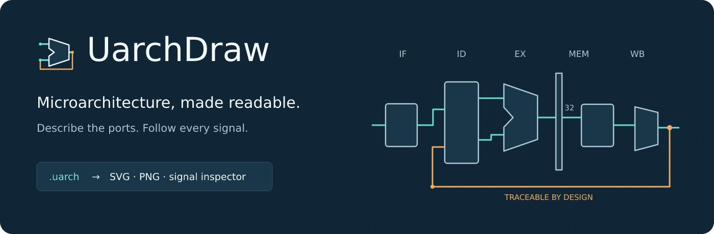
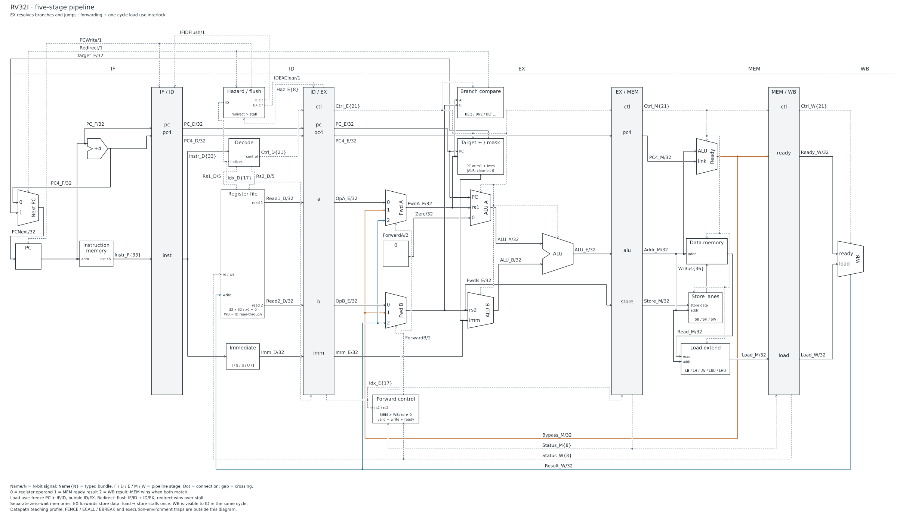

<p align="center">
  
</p>

<p align="center">
  <strong>Text to textbook-style datapaths. Explicit ports. Traceable signals.</strong><br>
  <a href="docs/quickstart.md">Quick start</a> ·
  <a href="examples/README.md">Examples</a> ·
  <a href="docs/authoring.md">Automatic authoring</a> ·
  <a href="docs/architecture.md">Architecture</a>
</p>

<p align="center">
  
  
  <a href="LICENSE"></a>
</p>

UarchDraw turns a small, explicit hardware description into an editable SVG.
Describe blocks, typed ports and connections. Parameters, arrays and templates
reduce repetition; the engine measures symbols, separates data/control lanes,
routes wires and expands spacing when needed. Optional hints handle demanding
layouts. Every exported diagram passes the same geometry audit.



<p align="center"><em>Generated from <a href="examples/05-rv32i-forwarding.uarch">one .uarch source</a>: 26 components, 49 named nets, 81 receiving ports.</em></p>

## Why UarchDraw?

- **Hardware-shaped diagrams.** ALUs, adders, MUXes and pipeline registers have distinct outlines and real pin anchors.
- **Electrical identity.** Each net has one driver and explicit destinations. Bundles retain named fields and widths.
- **Automatic authoring.** Optional port sides and placement, parameterized arrays, reusable port templates and merged fanout connections.
- **Hierarchy views.** Render an expanded graph, collapse groups for an overview, or focus on a nested group with its real boundary connections.
- **Readable paths.** Named alignment constraints, shared fanout trees and separate return corridors keep the structure visible.
- **Every signal named.** Labels reserve routing space. An impossible route or label placement produces a diagnostic instead of a silently incomplete diagram.
- **Inspectable output.** Editable SVG, 2400px PNG, grayscale previews, an offline signal inspector and a complete signal index come from the same model.
- **Reproducible checks.** Fixed font metrics, deterministic layouts, geometry audits and a tested five-stage RV32I teaching profile.

## Start in a minute

Requires **Node.js 22+** and npm. Tested on Windows x64 and Ubuntu 24.04 / WSL2
x64 with Node.js 22 and 24;
see the [validation record](docs/validation.md) for the exact environments.

From a source checkout:

```sh
npm ci
npm run build
node dist/cli.js init design.uarch
node dist/cli.js watch design.uarch
```

Open `output/design.svg` or `output/design.html`. Save the source to rebuild;
refresh your viewer to see changes. Ctrl+C stops the watcher.
In Windows PowerShell, use `npm.cmd` if the execution policy blocks `npm.ps1`.

To register the command from your local checkout:

```sh
npm link
uarchdraw render examples/05-rv32i-forwarding.uarch -o output/cpu
uarchdraw check examples/05-rv32i-forwarding.uarch
```

These instructions use the local checkout; no public registry release is required.

## A diagram is a source file

```text
uarch 2
param W = 32
title "Your first datapath"

block compute {
  label "Compute"
  out result: bits(W)
}
block latch: register(W) { label "Result register" }
connect compute.result -> latch.d
```

Blocks contain their typed ports; connections define topology. Start with the
[step-by-step course](examples/tutorials/README.md); use
[automatic authoring](docs/authoring.md) as the syntax reference. Existing explicit sources and
canonical exports use the [version-1 language](docs/language.md).

## Learn by building

| Lesson | Guide | What you build |
| --- | --- | --- |
| 01 | [First connection](examples/tutorials/01.md) | Rectangle → output port → connected register |
| 02 | [Types and fanout](examples/tutorials/02.md) | Parameterized width and a second receiver |
| 03 | [MUX and ALU](examples/tutorials/03.md) | Operand selection and distinct data/control paths |
| 04 | [Arrays](examples/tutorials/04.md) | Four → eight → sixteen inputs with one parameter |
| 05 | [Templates](examples/tutorials/05.md) | Reusable interfaces with local arguments |
| 06 | [Bundles and FIFO](examples/tutorials/06.md) | Status → returned commands → ready/valid datapath |
| 07 | [Hierarchy](examples/tutorials/07.md) | Full graph → overview → nested detail |
| 08 | [Layout](examples/tutorials/08.md) | Automatic spacing recovery and one fixed anchor |
| 09 | [Arbiter](examples/tutorials/09.md) | Requests, grants, backpressure and scalable data inputs |

Every step has complete source, commands, syntax explanations and a generated
result image. The course includes 25 checkpoints, nine exercise answers and five
deliberate errors with repairs. Run `npm run tutorials` to rebuild its assets.
The [reference gallery](examples/README.md) retains fourteen complete circuits,
including the RV32I pipeline. Run `npm run examples` for their previews.

Run `npm run review:all` to regenerate the examples, parameter/layout variants,
deliberate failure probes and image hashes. Reports and draft drawings are saved
in ignored `output/`; published lesson and gallery previews stay with their guides.

## Export and inspect

```sh
uarchdraw render design.uarch -o output/design
uarchdraw render design.uarch --svg-only
uarchdraw check design.uarch
```

`render` produces the diagram, grayscale versions, `.html` inspector,
`.signals.md` index, `.qa.json` audit, `.planning.json`, `.layout.json`, design JSON and a canonical
`.uarch` copy. `--svg-only` / `--png-only` select standalone image formats; the
HTML inspector and diagnostic data are still produced. `check` writes no files.

The inspector supports signal search, click-to-lock highlighting, endpoint
highlighting and zoom. Open the HTML file in your browser; it needs no server or
network connection. See [CLI and output details](docs/quickstart.md).

## Scope and limits

UarchDraw is an architecture-diagram tool. The language describes connections;
it does not infer a CPU, synthesize RTL or define component behavior.

The RV32I example resolves branches in EX and includes MEM/WB forwarding, a
one-cycle load-use interlock, store-data forwarding and redirect flushes. Its
execution witness covers selected instruction sequences, **not full ISA compliance**.
See the [CPU profile](docs/rv32i.md).

Dense designs can still require pin-order or alignment hints. Automatic spacing
retries are bounded and do not guarantee a readable result for arbitrary graphs.
Templates reuse ports and presentation, not internal subcircuits; external template
imports, bundle slicing and RTL behavior remain unsupported. Use the vector
diagram or hierarchy/detail views for large datapaths. English/Latin diagram text is the
tested font profile. Documentation, examples and the inspector are maintained
in English.

## Develop

```sh
npm run verify       # complete repository, test, drawing and package checks
npm test             # model, geometry, CLI, examples and pipeline witness
npm run check:repo   # repository language, documentation links and file hygiene
npm run review:all   # all examples, layout variants, probes and RV32I detail crops
npm run branding    # regenerate the original SVG/PNG brand assets
npm run test:package # install and verify the packed command and library
npm pack            # build a standalone installable package
```

Read [CONTRIBUTING.md](CONTRIBUTING.md) for the visual review checklist and
[architecture notes](docs/architecture.md) for the pipeline. CI is configured for
Node 22/24 on Windows and Linux; a local run is not a claim that remote CI has run.

See the [local validation record](docs/validation.md) for exact checks and limits.

## Repository layout

| Directory | Contents |
| --- | --- |
| `src/` | Parser, model, layout, routing, SVG export and offline inspector |
| `src/test/` | Engine, CLI, tutorial and pipeline regression tests |
| `examples/` | Step-by-step lessons, checkpoints, solutions and fourteen circuit references |
| `docs/` | Current user references, architecture notes and gallery previews |
| `scripts/` | Example generation, repository checks and package verification |
| `assets/` | Bundled font and its license |
| `.github/` | CI and contributor issue/pull-request templates |

Generated builds and local diagrams are kept in ignored `dist/` and `output/`.
See the [documentation index](docs/README.md) and [contributing/release guide](CONTRIBUTING.md).

## License

[GPL-3.0-or-later](LICENSE). The bundled font and dependencies retain their own
licenses; see [third-party notices](THIRD_PARTY_NOTICES.md).
