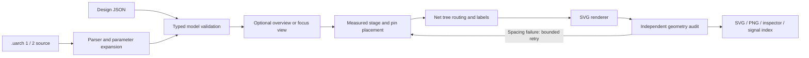

# Engine architecture

[Home](../README.md) · [Language](language.md) · [CPU profile](rv32i.md)

## Model and placement

`model.ts` keeps component IDs, explicit ports, structural signal types and nets
separate from output geometry. `schema.ts` checks runtime values, unknown options
and structural shapes before geometry. `dsl.ts` parses version-1 source;
`authoring.ts` expands version-2 parameters, interface templates, typed arrays
and scoped groups into the same model without evaluating JavaScript.

`automatic.ts` uses ELK with measured symbol sizes to order automatic nodes within
architectural stages. Separate data/control passes keep control below the data
path. Fixed anchors can coexist with automatic peers. Port-side inference and
operand alignment reduce physical hints in ordinary source files. These are
heuristics; stage order and explicit constraints still define the architecture.

`views.ts` derives overview and focus models from logical groups, retaining the
original boundary net IDs and types. Focus includes the real external drivers
and receivers. Group membership is validated for cycles, containment and sibling
overlap; groups are view boundaries rather than simulated modules.

`layout.ts` sizes symbols from text metrics, pin counts and row spans. Named pin
alignment preserves horizontal operand paths. Dependencies are resolved before
routing; cycles fail. Geometry is generated anew rather than saved into source.

Shaped-symbol pins are quantized to valid outline/grid intersections. The default
pipeline span is shared with model validation. Canvas bounds include actual
aligned symbols, measured document text and a footer area sized for the notes.
Unused space at the end of the final row is excluded from the body bounds;
declared pipeline spans remain intact.

## Routing and labels

`router.ts` uses direction-aware grid A* with symbol obstacles and real pin
escapes. Each net grows one shared tree from its unique source. Foreign nets
cannot share segments or create ambiguous T junctions. Crossings are permitted
only through interiors; branch dots come from actual adjacency. Unused channel
tails are pruned. If a preferred corridor disappears during pruning, its label
is placed again against the final wires.

Top/bottom corridors carry returns. `labels.ts` places each net's name in legal
space, avoiding all current wires and every pin's escape. Placed labels become
obstacles for subsequent routes. Horizontal labels are preferred over rotated
labels; failure to place a name rejects the layout.

Dynamic label obstacles use the same point-in-rectangle test as initial obstacles.
Rounding the entire covered grid range outward would block an extra row and can
make an otherwise legal parallel bus fail.

## Rendering and audit

`svg.ts` renders true ALU/MUX polygons, receiving arrows, junctions, searchable
text and hover identity. `font.ts` uses bundled DejaVu Sans for both measurement
and resvg rasterization, making geometry independent of installed system fonts.
Rectangular side-port names are centered on their electrical anchors where
possible. Alternate positions must stay in that port's own vertical lane;
the SVG audit checks these lane boundaries independently.

`audit.ts` reads the rendered outlines and glyph bounds independently of router
obstacle exceptions. It checks symbol overlap, pins on outlines, connected
destinations, islands, shared segments, ambiguous crossings, junction dots,
visible signal labels and their proximity to their own wires, text collisions
and clipping. Metrics include bends,
crossings and label coverage; they are diagnostics rather than a readability score.

The audit also checks symbol/canvas bounds and parses the visible SVG wire paths.
Their unit segments must match the routed model. Deleting a rendered wire or
changing only its path therefore fails even if the model remains connected.

`compile.ts` coordinates the pipeline without file writes. It tries at most four
deterministic spacing profiles, measuring label widths and expanding column gaps
and row spacing when routing or audit fails. The first passing profile wins;
successful explicit layouts retain their original geometry. Invalid anchors and
coincident pins fail immediately. A routing-grid budget bounds search memory.
The returned planning report records attempts and effective spacing.

`cli.ts` handles input/output, exclusive starter creation and serialized watch
rebuilds. Invalid edits preserve the last verified drawing, and a subsequent valid
save recovers. Viewers require a manual refresh. `inspect.ts` generates a standalone reader and signal table from
the same model. The SVG is embedded in the reader, not redrawn by a second engine.

## Architectural verification

`src/test/fixtures/pipeline.ts` is an RV32I teaching witness. It reads values through the declared
net graph for selected instructions. It is separate from the general diagram
compiler; `operation` tags do not turn arbitrary diagrams into simulations.
The fixture and shipped `.uarch` example are compared in tests.

## Current boundaries

- Templates reuse ports and presentation; internal subcircuits and file imports
  are not supported. Groups provide hierarchy views of a single connectivity model.
- No bit slices, concatenation or arbitrary behavioral simulation.
- Bounded spacing retries can still fail and can enlarge the drawing; they do
  not optimize a global readability score or guarantee a planar route.
- Fixed symbol family and tested Latin font profile.
- Explicit CPU layout constraints remain necessary for the flagship figure.
- `npm run review:all` reproduces parameter, hierarchy, layout and deliberate
  failure probes. Reports live in ignored `output/`; published previews stay with their guides.
- The local HTML reader's browser interaction has not been exercised in this
  environment because local-file browser automation is blocked; SVG, PNG,
  catalog data and JavaScript syntax have been checked.

See [contributing](../CONTRIBUTING.md) for visual review and brand asset generation.
