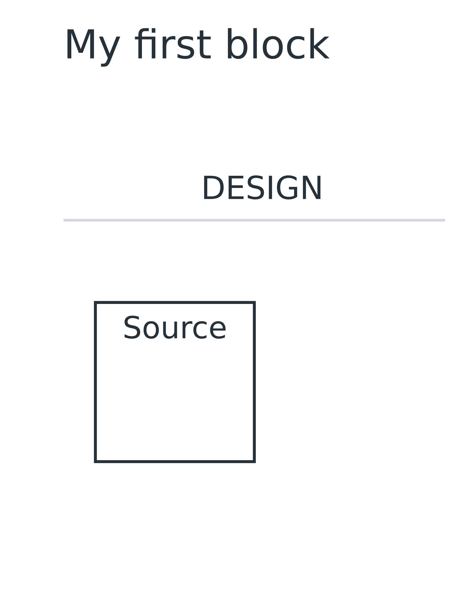
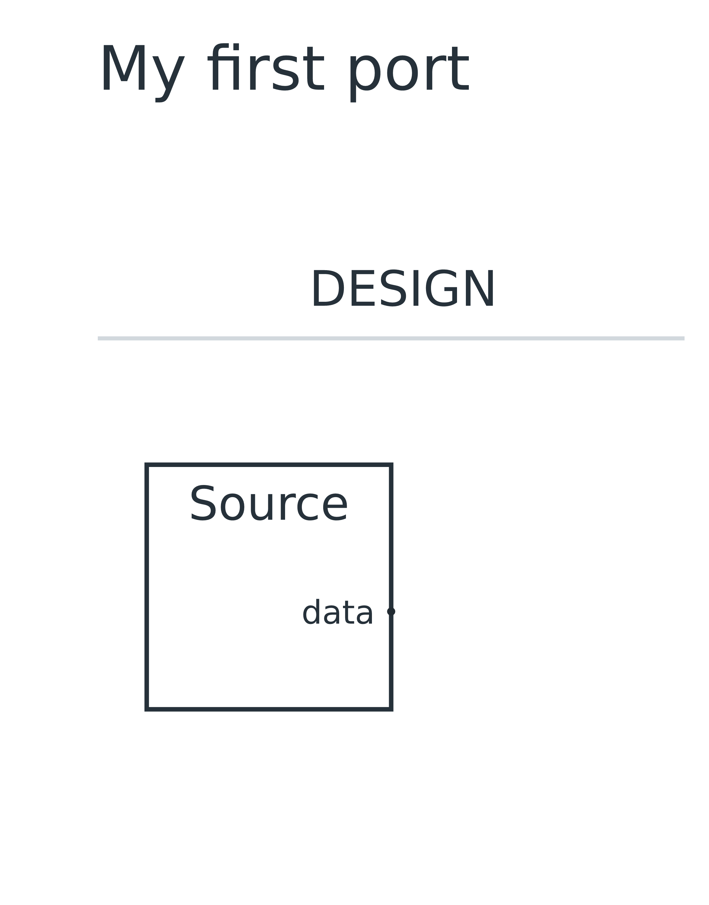
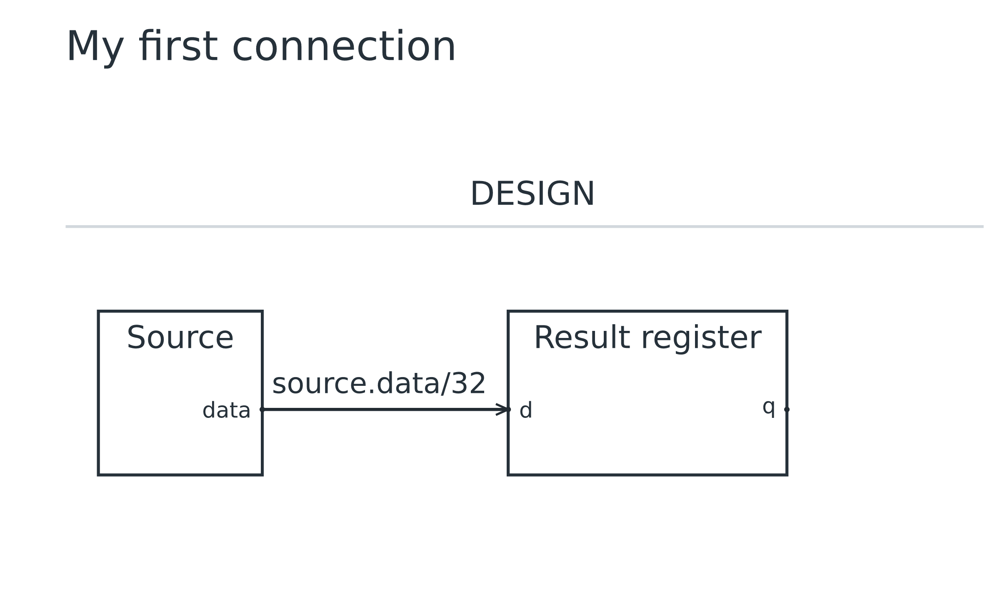
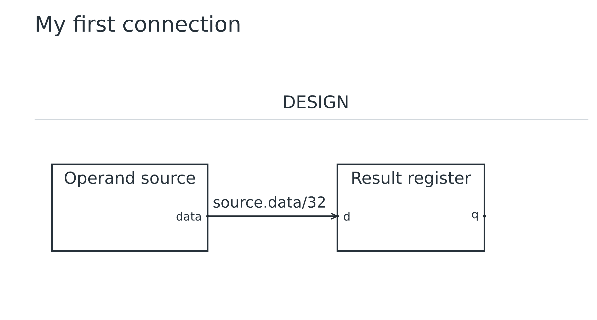

# Lesson 01: Draw your first connection

[Course](README.md) · [Setup](README.md#setup) · [Next: Types, parameters and fanout](02.md)

**Goal:** Build a source block and connect its result to a register.

## Before you start

- Install and build UarchDraw using the course setup instructions.

Run every command from the repository root after building. Use a plain-text editor. For each step, replace the contents of `work.uarch` with the complete source below. These are runnable checkpoints, not fragments to paste blindly into the previous file. Keep your own edits in `work.uarch`; the checked-in checkpoint is your recovery copy.

## Step 1: Draw one block

- Create a plain-text file named work.uarch. Paste this complete source into it.
- uarch 2 selects the authoring language; title names the drawing.
- block source gives the component a stable ID. label changes the displayed name. Braces contain declarations for this block.

[Complete checkpoint source](01-01-block.uarch)

```text
uarch 2
title "My first block"
block source {
  label "Source"
}
```

### Run it

```sh
node dist/cli.js check work.uarch
node dist/cli.js render work.uarch -o output/tutorial-work
```

Open `output/tutorial-work.svg` or `output/tutorial-work.png`. Refresh the viewer after each successful render. Compare your result with this image; a different output folder does not change the diagram.

### What you should see

**Checkpoint:** 1 symbol and 0 named nets.

- One rectangle named Source appears under the default DESIGN stage.
- There are no ports or wires yet.



## Step 2: Give the block an output

- Keep the block and add out data: bits(32) inside its braces.
- out declares a driver port; data is its local ID; bits(32) declares a 32-bit scalar.
- The tool chooses the right edge for this data output. You have not specified coordinates.

[Complete checkpoint source](01-02-port.uarch)

```text
uarch 2
title "My first port"
block source {
  label "Source"
  out data: bits(32)
}
```

### Run it

```sh
node dist/cli.js check work.uarch
node dist/cli.js render work.uarch -o output/tutorial-work
```

Open `output/tutorial-work.svg` or `output/tutorial-work.png`. Refresh the viewer after each successful render. Compare your result with this image; a different output folder does not change the diagram.

### What you should see

**Checkpoint:** 1 symbol and 0 named nets.

- The rectangle gains an output anchor and the port name data.
- An output does not need a receiver. There is still no wire.



## Step 3: Connect a result register

- Append a second block and a connect statement after the source block.
- register(32) is a built-in interface with input d and output q. The colon selects the symbol/interface constructor.
- source.data and capture.d identify block ports. The arrow declares one driver and one receiving input.
- Inputs must be driven unless explicitly optional; declaring capture and its connection together keeps this checkpoint valid.

[Complete checkpoint source](01-03-connect.uarch)

```text
uarch 2
title "My first connection"
block source {
  label "Source"
  out data: bits(32)
}

block capture: register(32) {
  label "Result register"
}
connect source.data -> capture.d
```

### Run it

```sh
node dist/cli.js check work.uarch
node dist/cli.js render work.uarch -o output/tutorial-work
```

Open `output/tutorial-work.svg` or `output/tutorial-work.png`. Refresh the viewer after each successful render. Compare your result with this image; a different output folder does not change the diagram.

### What you should see

**Checkpoint:** 2 symbols and 1 named net, 1 receiving port.

- Source is on the left and Result register is on the right.
- A labeled 32-bit wire ends with an arrow at the receiving d port.
- The register q port has no wire yet; drawing a register does not simulate its clocked behavior.



## Try it yourself

Rename the displayed Source to Operand source without changing its block ID or connection.

Make the change in `work.uarch`, then check, render and inspect it before opening the answer.

<details>
<summary>Show the complete answer and expected image</summary>

[Runnable answer](solutions/01.uarch)

- Change only label. source.data still identifies the driver.
- The block grows to fit the longer display name; connectivity stays at one net and one sink.

```text
uarch 2
title "My first connection"
block source {
  label "Operand source"
  out data: bits(32)
}

block capture: register(32) {
  label "Result register"
}
connect source.data -> capture.d
```

```sh
node dist/cli.js render examples/tutorials/solutions/01.uarch -o output/tutorial-answer-01
```

**Checkpoint:** 2 symbols and 1 named net, 1 receiving port.



</details>

## Before you move on

Explain these points using your own drawing:

- How does changing a display label differ from changing a block ID?
- Which declaration creates the output port, and which declaration creates the wire?

Confirm the visible result, not just the command exit code. [Next: Types, parameters and fanout](02.md).
