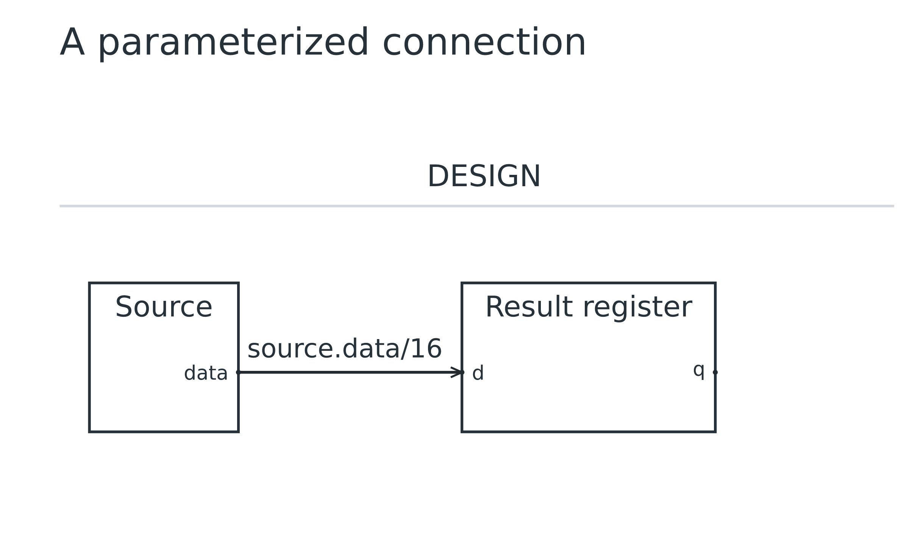
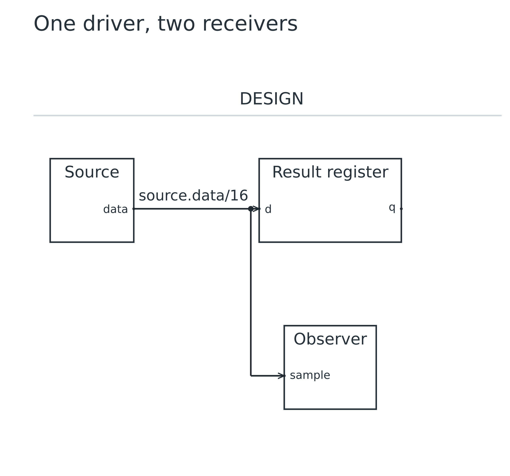

# Lesson 02: Types, parameters and fanout

[Course](README.md) · [Previous: Draw your first connection](01.md) · [Next: Select an ALU operand](03.md)

**Goal:** Change one width parameter and give one driver multiple receivers.

## Before you start

- Complete lesson 01. Start from its connected source and register.

Run every command from the repository root after building. Use a plain-text editor. For each step, replace the contents of `work.uarch` with the complete source below. These are runnable checkpoints, not fragments to paste blindly into the previous file. Keep your own edits in `work.uarch`; the checked-in checkpoint is your recovery copy.

## Step 1: Make the width a parameter

- Insert param W = 16 before the declarations that use W. Replace both hard-coded widths with W.
- A parameter is a named integer used during expansion. Both ends still have exactly the same type.
- Default wire labels follow the driver type, so /16 now appears without editing a label.

[Complete checkpoint source](02-01-width.uarch)

```text
uarch 2
param W = 16
title "A parameterized connection"
block source {
  label "Source"
  out data: bits(W)
}

block capture: register(W) {
  label "Result register"
}
connect source.data -> capture.d
```

### Run it

```sh
node dist/cli.js check work.uarch
node dist/cli.js render work.uarch -o output/tutorial-work
```

Open `output/tutorial-work.svg` or `output/tutorial-work.png`. Refresh the viewer after each successful render. Compare your result with this image; a different output folder does not change the diagram.

### What you should see

**Checkpoint:** 2 symbols and 1 named net.

- The topology is unchanged: two blocks and one wire.
- The wire width annotation changes from /32 to /16.



## Step 2: Add a second receiver

- Add Observer and its required sample input, then append another connect from source.data.
- Separate connect statements from the same driver merge into one net. Do not invent another output to represent the branch.
- A junction dot marks a connected branch. A crossing without that dot is not a connection.

[Complete checkpoint source](02-02-fanout.uarch)

```text
uarch 2
param W = 16
title "One driver, two receivers"
block source {
  label "Source"
  out data: bits(W)
}

block capture: register(W) {
  label "Result register"
}
connect source.data -> capture.d

block observer {
  label "Observer"
  in sample: bits(W)
}
connect source.data -> observer.sample
```

### Run it

```sh
node dist/cli.js check work.uarch
node dist/cli.js render work.uarch -o output/tutorial-work
```

Open `output/tutorial-work.svg` or `output/tutorial-work.png`. Refresh the viewer after each successful render. Compare your result with this image; a different output folder does not change the diagram.

### What you should see

**Checkpoint:** 3 symbols and 1 named net, 2 receiving ports.

- One source reaches both the register and Observer.
- There is one named net with two receiving ports, rather than two independent driver nets.



## Make a mistake and repair it

Try these deliberately broken copies separately from your working file. `check` must exit with status 1 and print the named error; it does not write diagrams. An old preview is not evidence that a failed command succeeded.

### Mismatch one receiver width

[Deliberately faulty source](errors/02-width-mismatch.uarch)

```sh
node dist/cli.js check examples/tutorials/errors/02-width-mismatch.uarch
```

**Expected error fragment:** `incompatible types`.

- Observer now expects 8 bits, while Source still drives 16 bits.
- Fix the receiver to bits(W). Editing the visible wire label cannot repair a type mismatch.

After trying the repair in `work.uarch`, run its normal `check` and `render` commands again. Recover by pasting the matching successful checkpoint if needed.

## Try it yourself

Change the whole fanout diagram to 64 bits by editing only the parameter.

Make the change in `work.uarch`, then check, render and inspect it before opening the answer.

<details>
<summary>Show the complete answer and expected image</summary>

[Runnable answer](solutions/02.uarch)

- All three ports use W. One parameter edit updates every endpoint and the automatic /64 annotation.

```text
uarch 2
param W = 64
title "One driver, two receivers"
block source {
  label "Source"
  out data: bits(W)
}

block capture: register(W) {
  label "Result register"
}
connect source.data -> capture.d

block observer {
  label "Observer"
  in sample: bits(W)
}
connect source.data -> observer.sample
```

```sh
node dist/cli.js render examples/tutorials/solutions/02.uarch -o output/tutorial-answer-02
```

**Checkpoint:** 3 symbols and 1 named net, 2 receiving ports.


</details>

## Before you move on

Explain these points using your own drawing:

- Why must every receiving port have the same type as its driver?
- Why does the fanout checkpoint contain one net even though it reaches two inputs?

Confirm the visible result, not just the command exit code. [Next: Select an ALU operand](03.md).
