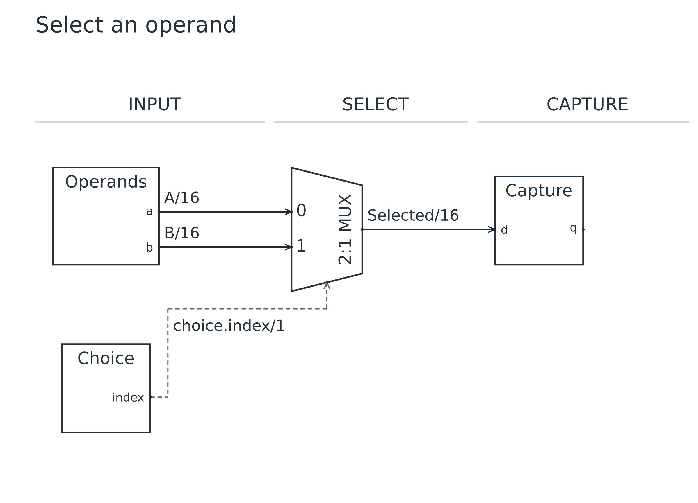
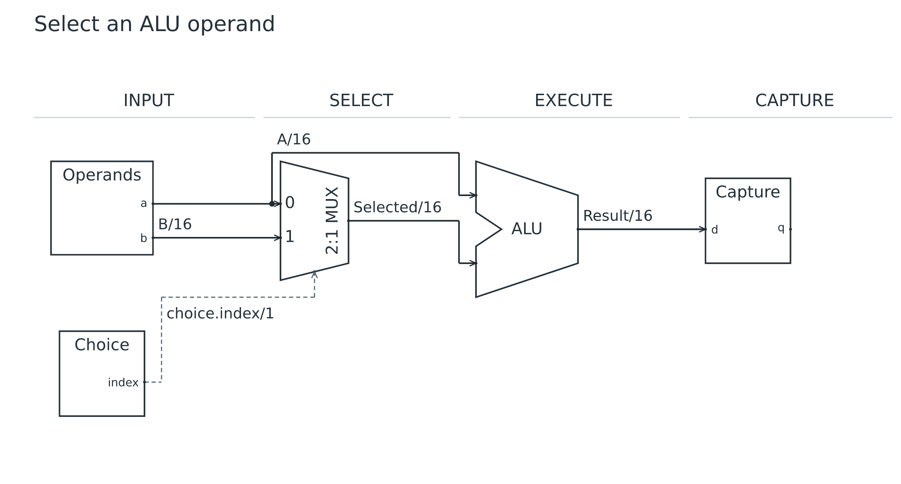
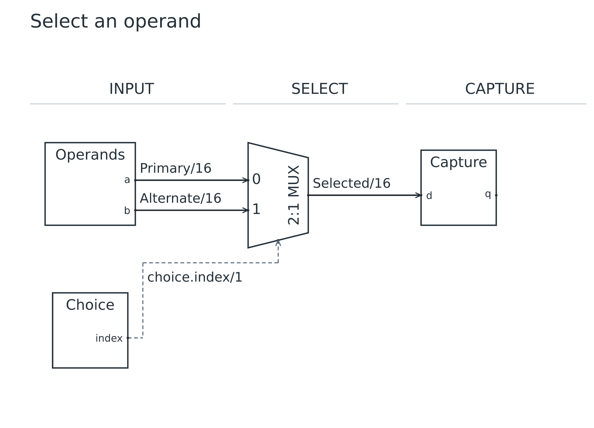

# Lesson 03: Select an ALU operand

[Course](README.md) · [Previous: Types, parameters and fanout](02.md) · [Next: Scale with port arrays](04.md)

**Goal:** Add a MUX, its control input and a distinct ALU symbol.

## Before you start

- Complete lesson 02. This lesson starts a new operand-selection diagram.

Run every command from the repository root after building. Use a plain-text editor. For each step, replace the contents of `work.uarch` with the complete source below. These are runnable checkpoints, not fragments to paste blindly into the previous file. Keep your own edits in `work.uarch`; the checked-in checkpoint is your recovery copy.

## Step 1: Build a two-input selector

- Replace work.uarch with this complete source; this is a new diagram, not an append to lesson 02.
- stages declares the architectural left-to-right sequence. in INPUT assigns a block to a stage.
- mux(2, W) creates d[0], d[1], select and out. Square brackets address one element of its data-port array.
- bit means bits(1). Choice produces the required one-bit select input. role control describes its lane; style control makes its net dashed.
- Connection options use braces. label overrides display text but does not change signal type.

[Complete checkpoint source](03-01-mux.uarch)

```text
uarch 2
title "Select an operand"
param W = 16
stages INPUT SELECT CAPTURE
block operands in INPUT {
  label "Operands"
  out a: bits(W)
  out b: bits(W)
}
block choice in INPUT {
  label "Choice"
  role control
  out index: bit
}
block select: mux(2, W) in SELECT
block capture: register(W) in CAPTURE { label "Capture" }
connect operands.a -> select.d[0] { label "A/16" }
connect operands.b -> select.d[1] { label "B/16" }
connect choice.index -> select.select { style control }
connect select.out -> capture.d { label "Selected/16" }
```

### Run it

```sh
node dist/cli.js check work.uarch
node dist/cli.js render work.uarch -o output/tutorial-work
```

Open `output/tutorial-work.svg` or `output/tutorial-work.png`. Refresh the viewer after each successful render. Compare your result with this image; a different output folder does not change the diagram.

### What you should see

**Checkpoint:** 4 symbols and 4 named nets.

- Two data wires enter the tapered MUX at input 0 and input 1.
- A dashed control wire enters select; the selected data reaches Capture.
- All four nets have visible names; /16 is a display convention, and the actual width comes from the ports.



## Step 2: Put an ALU after the selector

- Insert EXECUTE between SELECT and CAPTURE. Add a custom alu block with explicit a, b and result ports.
- Replace the old MUX-to-register connection with MUX-to-ALU and ALU-to-register connections.
- Append the connection from operands.a to compute.a with the same explicit label as its existing fanout net.
- The alu symbol has two operand edges and a central input notch. Naming a block ALU alone would not select this shape.

[Complete checkpoint source](03-02-alu.uarch)

```text
uarch 2
title "Select an ALU operand"
param W = 16
stages INPUT SELECT EXECUTE CAPTURE
block operands in INPUT {
  label "Operands"
  out a: bits(W)
  out b: bits(W)
}
block choice in INPUT {
  label "Choice"
  role control
  out index: bit
}
block select: mux(2, W) in SELECT
block capture: register(W) in CAPTURE { label "Capture" }
connect operands.a -> select.d[0] { label "A/16" }
connect operands.b -> select.d[1] { label "B/16" }
connect choice.index -> select.select { style control }

block compute: alu in EXECUTE {
  label "ALU"
  in a: bits(W)
  in b: bits(W)
  out result: bits(W)
}
connect operands.a -> compute.a { label "A/16" }
connect select.out -> compute.b { label "Selected/16" }
connect compute.result -> capture.d { label "Result/16" }
```

### Run it

```sh
node dist/cli.js check work.uarch
node dist/cli.js render work.uarch -o output/tutorial-work
```

Open `output/tutorial-work.svg` or `output/tutorial-work.png`. Refresh the viewer after each successful render. Compare your result with this image; a different output folder does not change the diagram.

### What you should see

**Checkpoint:** 5 symbols and 5 named nets.

- ALU appears between the MUX and Capture.
- A now branches to MUX input 0 and ALU input a. Selected enters ALU input b.
- The figure describes connectivity; it does not evaluate select values or ALU arithmetic.



## Make a mistake and repair it

Try these deliberately broken copies separately from your working file. `check` must exit with status 1 and print the named error; it does not write diagrams. An old preview is not evidence that a failed command succeeded.

### Remove the MUX control connection

[Deliberately faulty source](errors/03-undriven-select.uarch)

```sh
node dist/cli.js check examples/tutorials/errors/03-undriven-select.uarch
```

**Expected error fragment:** `Undriven input select.select`.

- The MUX still has a required select input. Restore its connect statement.
- UarchDraw rejects a missing electrical connection instead of drawing an apparently complete selector.

After trying the repair in `work.uarch`, run its normal `check` and `render` commands again. Recover by pasting the matching successful checkpoint if needed.

## Try it yourself

Change the visible names A/16 and B/16 to Primary/16 and Alternate/16 without swapping their destinations.

Make the change in `work.uarch`, then check, render and inspect it before opening the answer.

<details>
<summary>Show the complete answer and expected image</summary>

[Runnable answer](solutions/03.uarch)

- Only labels change. operands.a still drives d[0], and operands.b still drives d[1].
- To change topology you would edit the destinations, not the visible names.

```text
uarch 2
title "Select an operand"
param W = 16
stages INPUT SELECT CAPTURE
block operands in INPUT {
  label "Operands"
  out a: bits(W)
  out b: bits(W)
}
block choice in INPUT {
  label "Choice"
  role control
  out index: bit
}
block select: mux(2, W) in SELECT
block capture: register(W) in CAPTURE { label "Capture" }
connect operands.a -> select.d[0] { label "Primary/16" }
connect operands.b -> select.d[1] { label "Alternate/16" }
connect choice.index -> select.select { style control }
connect select.out -> capture.d { label "Selected/16" }
```

```sh
node dist/cli.js render examples/tutorials/solutions/03.uarch -o output/tutorial-answer-03
```

**Checkpoint:** 4 symbols and 4 named nets.



</details>

## Before you move on

Explain these points using your own drawing:

- Which MUX port is control, and how does it look different from the data wires?
- Trace what reaches ALU a, ALU b and the result register in the final checkpoint.

Confirm the visible result, not just the command exit code. [Next: Scale with port arrays](04.md).
