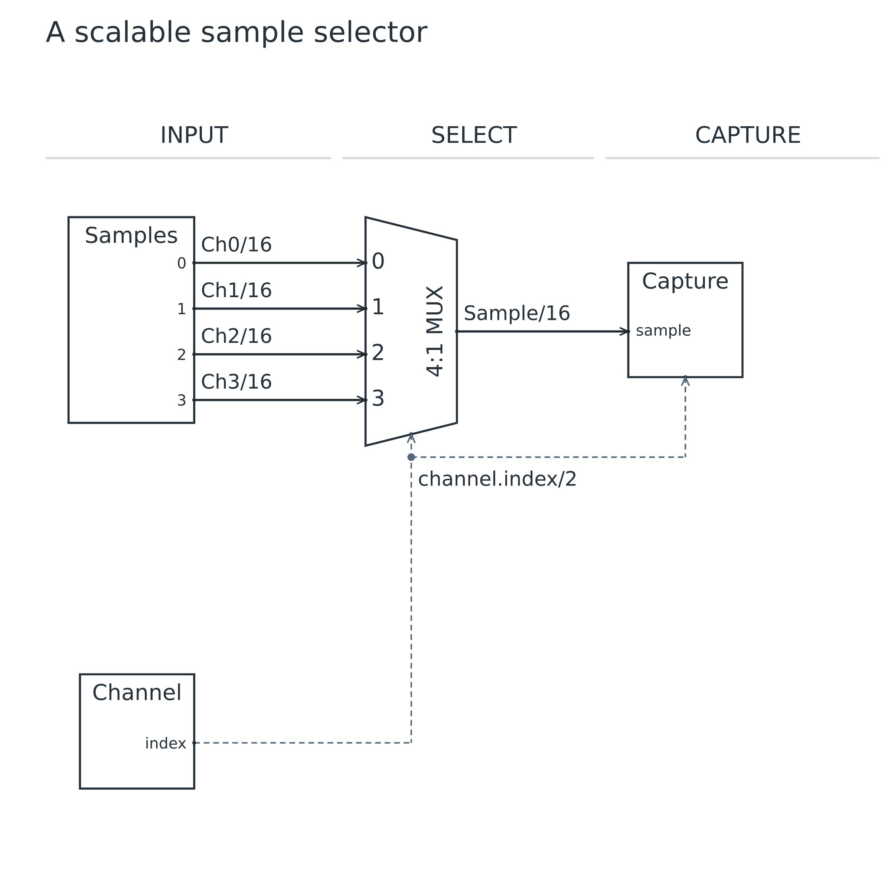
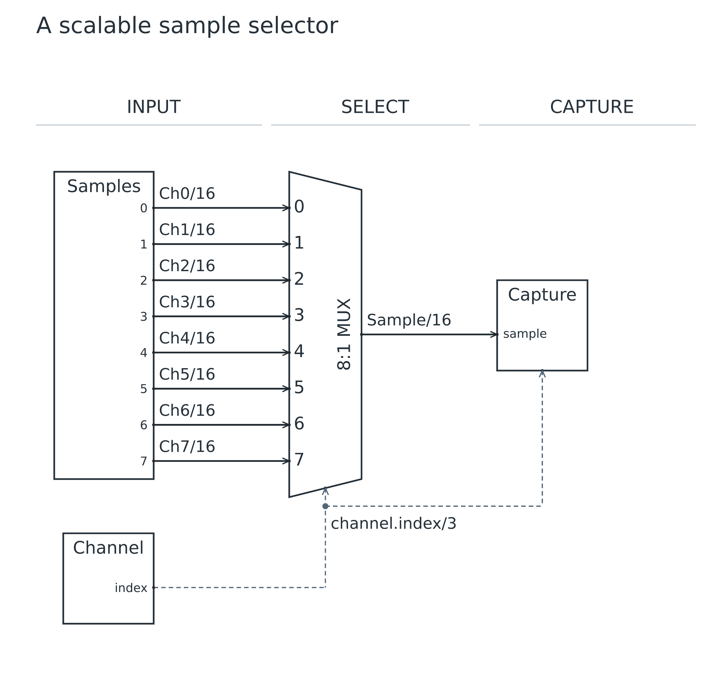
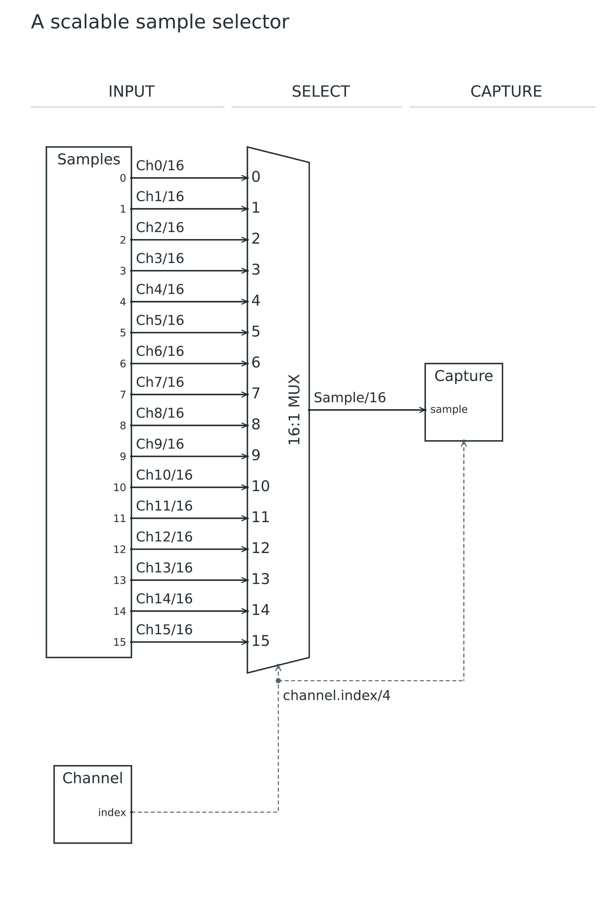

# Lesson 04: Scale with port arrays

[Course](README.md) · [Previous: Select an ALU operand](03.md) · [Next: Reuse interfaces with templates](05.md)

**Goal:** Grow a selector by changing parameters instead of repeating declarations.

## Before you start

- Complete lesson 03. Replace its separate operand declarations with a sample array.

Run every command from the repository root after building. Use a plain-text editor. For each step, replace the contents of `work.uarch` with the complete source below. These are runnable checkpoints, not fragments to paste blindly into the previous file. Keep your own edits in `work.uarch`; the checked-in checkpoint is your recovery copy.

## Step 1: Select four samples

- out data[N] creates N output ports. The ${index} display substitution numbers the ports from zero.
- [*] connects corresponding elements of two equally sized arrays. This one statement expands four data nets.
- clog2(N) computes the select width, with a minimum of one bit. Four inputs need two select bits.
- The comma-separated destinations fan out Channel to both the MUX select input and Capture tag.
- Bare register selects the shape while the body supplies a custom sample/tag interface; it does not add built-in d/q ports.

[Complete checkpoint source](04-01-four.uarch)

```text
uarch 2
title "A scalable sample selector"
param N = 4
param W = 16
param INDEX_W = clog2(N)
stages INPUT SELECT CAPTURE
block samples in INPUT {
  label "Samples"
  out data[N]: bits(W) { label "${index}" }
}
block channel in INPUT {
  label "Channel"
  role control
  out index: bits(INDEX_W)
}
block select: mux(N, W) in SELECT
block capture: register in CAPTURE {
  label "Capture"
  in sample: bits(W)
  in tag: bits(INDEX_W)
}
connect samples.data[*] -> select.d[*] { label "Ch${index}/${W}" }
connect channel.index -> select.select, capture.tag { style control }
connect select.out -> capture.sample { label "Sample/${W}" }
```

### Run it

```sh
node dist/cli.js check work.uarch
node dist/cli.js render work.uarch -o output/tutorial-work
```

Open `output/tutorial-work.svg` or `output/tutorial-work.png`. Refresh the viewer after each successful render. Compare your result with this image; a different output folder does not change the diagram.

### What you should see

**Checkpoint:** 4 symbols and 6 named nets, 7 receiving ports.

- Four named horizontal channel wires enter a 4:1 MUX.
- Channel/2 controls selection and also tags the captured sample.
- There are six nets: four channels, one index fanout and one selected sample.



## Step 2: Grow to eight samples

- Change only param N = 4 to param N = 8. Keep the port and connect declarations unchanged.
- The array expands, the MUX grows, and INDEX_W becomes three. ${index} and ${W} labels are recomputed.

[Complete checkpoint source](04-02-eight.uarch)

```text
uarch 2
title "A scalable sample selector"
param N = 8
param W = 16
param INDEX_W = clog2(N)
stages INPUT SELECT CAPTURE
block samples in INPUT {
  label "Samples"
  out data[N]: bits(W) { label "${index}" }
}
block channel in INPUT {
  label "Channel"
  role control
  out index: bits(INDEX_W)
}
block select: mux(N, W) in SELECT
block capture: register in CAPTURE {
  label "Capture"
  in sample: bits(W)
  in tag: bits(INDEX_W)
}
connect samples.data[*] -> select.d[*] { label "Ch${index}/${W}" }
connect channel.index -> select.select, capture.tag { style control }
connect select.out -> capture.sample { label "Sample/${W}" }
```

### Run it

```sh
node dist/cli.js check work.uarch
node dist/cli.js render work.uarch -o output/tutorial-work
```

Open `output/tutorial-work.svg` or `output/tutorial-work.png`. Refresh the viewer after each successful render. Compare your result with this image; a different output folder does not change the diagram.

### What you should see

**Checkpoint:** 4 symbols and 10 named nets.

- The MUX becomes 8:1, with eight data wires and a /3 channel index.
- All sample wires remain horizontal; no row, span or alignment edits are needed.



## Step 3: Grow to sixteen samples

- Change N to 16 and render again. A taller canvas is the cost of showing every input clearly.
- Read the SVG at a useful zoom rather than judging legibility from a small page thumbnail.

[Complete checkpoint source](04-03-sixteen.uarch)

```text
uarch 2
title "A scalable sample selector"
param N = 16
param W = 16
param INDEX_W = clog2(N)
stages INPUT SELECT CAPTURE
block samples in INPUT {
  label "Samples"
  out data[N]: bits(W) { label "${index}" }
}
block channel in INPUT {
  label "Channel"
  role control
  out index: bits(INDEX_W)
}
block select: mux(N, W) in SELECT
block capture: register in CAPTURE {
  label "Capture"
  in sample: bits(W)
  in tag: bits(INDEX_W)
}
connect samples.data[*] -> select.d[*] { label "Ch${index}/${W}" }
connect channel.index -> select.select, capture.tag { style control }
connect select.out -> capture.sample { label "Sample/${W}" }
```

### Run it

```sh
node dist/cli.js check work.uarch
node dist/cli.js render work.uarch -o output/tutorial-work
```

Open `output/tutorial-work.svg` or `output/tutorial-work.png`. Refresh the viewer after each successful render. Compare your result with this image; a different output folder does not change the diagram.

### What you should see

**Checkpoint:** 4 symbols and 18 named nets.

- The MUX becomes 16:1 with inputs 0 through 15, and the index width is /4.
- All sixteen channel labels remain visible and data paths stay horizontal.



## Make a mistake and repair it

Try these deliberately broken copies separately from your working file. `check` must exit with status 1 and print the named error; it does not write diagrams. An old preview is not evidence that a failed command succeeded.

### Connect arrays with different lengths

[Deliberately faulty source](errors/04-array-length.uarch)

```sh
node dist/cli.js check examples/tutorials/errors/04-array-length.uarch
```

**Expected error fragment:** `equal lengths`.

- Samples has four elements but the MUX now has five. Wildcard pairing requires equal lengths.
- Restore mux(N, W); the compiler will not silently drop or repeat an element.

After trying the repair in `work.uarch`, run its normal `check` and `render` commands again. Recover by pasting the matching successful checkpoint if needed.

## Try it yourself

Generate eight 64-bit samples by editing only N and W.

Make the change in `work.uarch`, then check, render and inspect it before opening the answer.

<details>
<summary>Show the complete answer and expected image</summary>

[Runnable answer](solutions/04.uarch)

- Set N to 8 and W to 64. The select index remains three bits; sample width becomes 64 bits.

```text
uarch 2
title "A scalable sample selector"
param N = 8
param W = 64
param INDEX_W = clog2(N)
stages INPUT SELECT CAPTURE
block samples in INPUT {
  label "Samples"
  out data[N]: bits(W) { label "${index}" }
}
block channel in INPUT {
  label "Channel"
  role control
  out index: bits(INDEX_W)
}
block select: mux(N, W) in SELECT
block capture: register in CAPTURE {
  label "Capture"
  in sample: bits(W)
  in tag: bits(INDEX_W)
}
connect samples.data[*] -> select.d[*] { label "Ch${index}/${W}" }
connect channel.index -> select.select, capture.tag { style control }
connect select.out -> capture.sample { label "Sample/${W}" }
```

```sh
node dist/cli.js render examples/tutorials/solutions/04.uarch -o output/tutorial-answer-04
```

**Checkpoint:** 4 symbols and 10 named nets.


</details>

## Before you move on

Explain these points using your own drawing:

- Which two parameters control channel count and sample width?
- Why does N = 16 need four index bits, and why must wildcard arrays have equal lengths?

Confirm the visible result, not just the command exit code. [Next: Reuse interfaces with templates](05.md).
