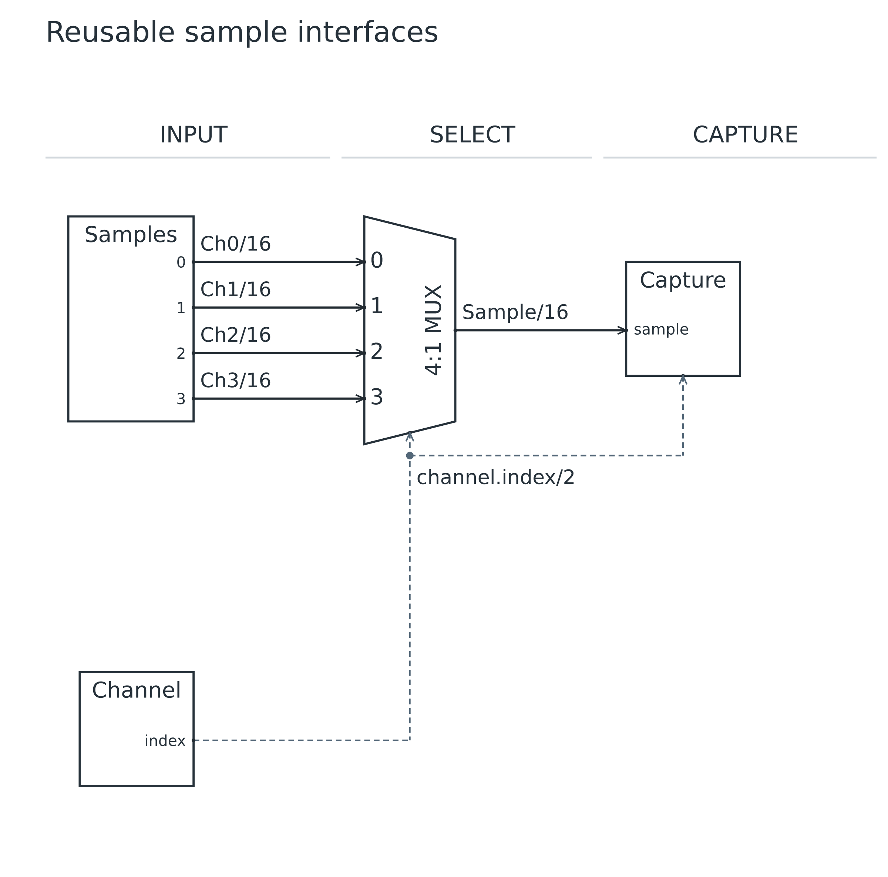
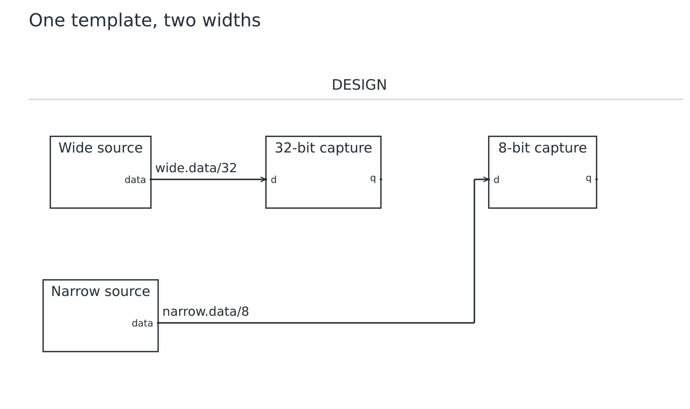

# Lesson 05: Reuse interfaces with templates

[Course](README.md) · [Previous: Scale with port arrays](04.md) · [Next: Bundles, feedback and a FIFO](06.md)

**Goal:** Refactor repeated port declarations without changing the circuit.

## Before you start

- Complete lesson 04. Start from its four-input checkpoint.

Run every command from the repository root after building. Use a plain-text editor. For each step, replace the contents of `work.uarch` with the complete source below. These are runnable checkpoints, not fragments to paste blindly into the previous file. Keep your own edits in `work.uarch`; the checked-in checkpoint is your recovery copy.

## Step 1: Extract the Samples interface

- Replace the Samples block body with a template definition and an instance of that template.
- COUNT and WIDTH are local template parameter names. Samples(N, W) binds the argument values to them.
- The template supplies ports and presentation; it does not instantiate internal subcircuits.
- Keep all connections unchanged: source IDs still belong to the samples instance.

[Complete checkpoint source](05-01-samples.uarch)

```text
uarch 2
title "Reusable sample interfaces"
param N = 4
param W = 16
param INDEX_W = clog2(N)
stages INPUT SELECT CAPTURE
template Samples(COUNT, WIDTH) {
  label "Samples"
  out data[COUNT]: bits(WIDTH) { label "${index}" }
}
block samples: Samples(N, W) in INPUT
block channel in INPUT {
  label "Channel"
  role control
  out index: bits(INDEX_W)
}
block select: mux(N, W) in SELECT
block capture: register in CAPTURE {
  label "Capture"
  in sample: bits(W)
  in tag: bits(INDEX_W)
}
connect samples.data[*] -> select.d[*] { label "Ch${index}/${W}" }
connect channel.index -> select.select, capture.tag { style control }
connect select.out -> capture.sample { label "Sample/${W}" }
```

### Run it

```sh
node dist/cli.js check work.uarch
node dist/cli.js render work.uarch -o output/tutorial-work
```

Open `output/tutorial-work.svg` or `output/tutorial-work.png`. Refresh the viewer after each successful render. Compare your result with this image; a different output folder does not change the diagram.

### What you should see

**Checkpoint:** 4 symbols and 6 named nets.

- The same four channel paths and six nets remain.
- This step improves reuse rather than adding hardware. Compare port names and destinations with lesson 04.


## Step 2: Extract a register interface

- Replace the custom Capture block with a TaggedCapture template.
- The : register on the template chooses the symbol kind. DATA_W and TAG_W bind locally for each instance.
- Instance IDs still define connectivity. A reusable template name does not appear in port references.

[Complete checkpoint source](05-02-capture.uarch)

```text
uarch 2
title "Reusable sample interfaces"
param N = 4
param W = 16
param INDEX_W = clog2(N)
stages INPUT SELECT CAPTURE
template Samples(COUNT, WIDTH) {
  label "Samples"
  out data[COUNT]: bits(WIDTH) { label "${index}" }
}
block samples: Samples(N, W) in INPUT
block channel in INPUT {
  label "Channel"
  role control
  out index: bits(INDEX_W)
}
block select: mux(N, W) in SELECT
template TaggedCapture(DATA_W, TAG_W): register {
  label "Capture"
  in sample: bits(DATA_W)
  in tag: bits(TAG_W)
}
block capture: TaggedCapture(W, INDEX_W) in CAPTURE
connect samples.data[*] -> select.d[*] { label "Ch${index}/${W}" }
connect channel.index -> select.select, capture.tag { style control }
connect select.out -> capture.sample { label "Sample/${W}" }
```

### Run it

```sh
node dist/cli.js check work.uarch
node dist/cli.js render work.uarch -o output/tutorial-work
```

Open `output/tutorial-work.svg` or `output/tutorial-work.png`. Refresh the viewer after each successful render. Compare your result with this image; a different output folder does not change the diagram.

### What you should see

**Checkpoint:** 4 symbols and 6 named nets.

- Capture keeps its sample and tag inputs and its register shape.
- The drawing remains a four-input selector; the interface definition is now reusable.



## Try it yourself

Instantiate the same output template at widths 8 and 32, and connect each instance to a matching receiver.

Make the change in `work.uarch`, then check, render and inspect it before opening the answer.

<details>
<summary>Show the complete answer and expected image</summary>

[Runnable answer](solutions/05.uarch)

- Output(8) and Output(32) bind independent local WIDTH values.
- Each receiver has the matching type. Reusing the template does not force all instances to one width.

```text
uarch 2
title "One template, two widths"
template Output(WIDTH) {
  out data: bits(WIDTH)
}
block narrow: Output(8) { label "Narrow source" }
block wide: Output(32) { label "Wide source" }
block narrow_capture: register(8) { label "8-bit capture" }
block wide_capture: register(32) { label "32-bit capture" }
connect narrow.data -> narrow_capture.d
connect wide.data -> wide_capture.d
```

```sh
node dist/cli.js render examples/tutorials/solutions/05.uarch -o output/tutorial-answer-05
```

**Checkpoint:** 4 symbols and 2 named nets.



</details>

## Before you move on

Explain these points using your own drawing:

- Which names belong to a template, and which belong to a block instance?
- Why can the same Output template produce both an 8-bit and a 32-bit interface?

Confirm the visible result, not just the command exit code. [Next: Bundles, feedback and a FIFO](06.md).
