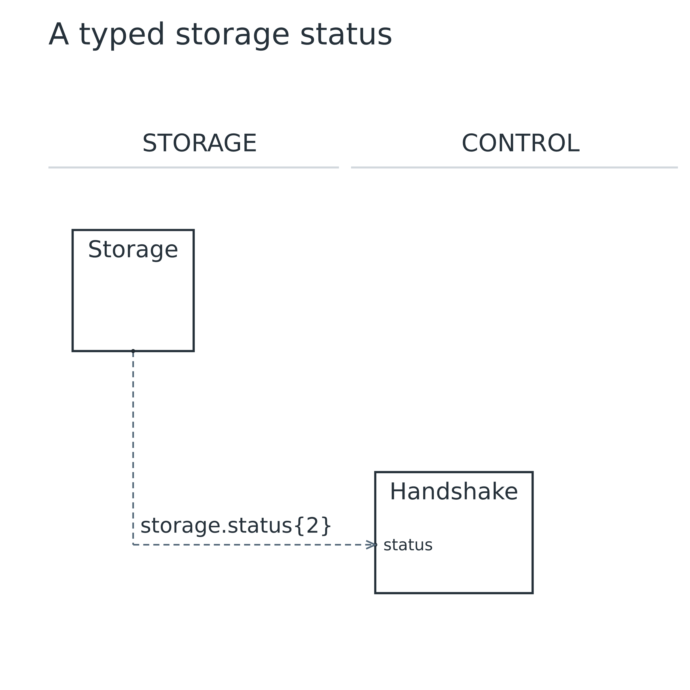
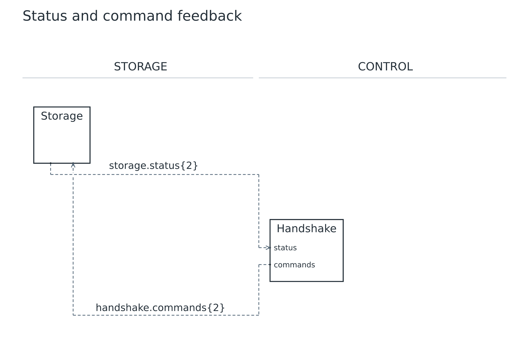
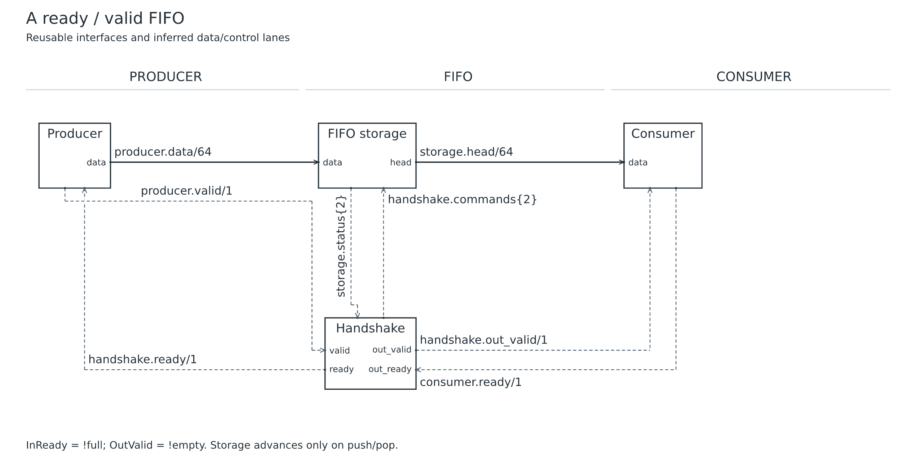

# Lesson 06: Bundles, feedback and a FIFO

[Course](README.md) · [Previous: Reuse interfaces with templates](05.md) · [Next: Derive hierarchy views](07.md)

**Goal:** Name bundle fields, route a return signal, then add a ready/valid datapath.

## Before you start

- Complete lessons 02 and 05. This lesson starts a new storage/control diagram.

Run every command from the repository root after building. Use a plain-text editor. For each step, replace the contents of `work.uarch` with the complete source below. These are runnable checkpoints, not fragments to paste blindly into the previous file. Keep your own edits in `work.uarch`; the checked-in checkpoint is your recovery copy.

## Step 1: Send a typed status bundle

- type Flags declares a structural bundle with named full and empty fields. Each field is one bit.
- Both ports use Flags. Equal total width alone would not make a different set of field names compatible.
- role data keeps Storage in the main lane even though its only current net is status. Handshake is a control block.
- Open the generated .signals.md file to read the bundle fields; the diagram shows one whole-bundle wire.

[Complete checkpoint source](06-01-status.uarch)

```text
uarch 2
title "A typed storage status"
stages STORAGE CONTROL
type Flags {
  full: 1
  empty: 1
}
block storage in STORAGE {
  label "Storage"
  role data
  out status: Flags
}
block handshake in CONTROL {
  label "Handshake"
  role control
  in status: Flags
}
connect storage.status -> handshake.status
```

### Run it

```sh
node dist/cli.js check work.uarch
node dist/cli.js render work.uarch -o output/tutorial-work
```

Open `output/tutorial-work.svg` or `output/tutorial-work.png`. Refresh the viewer after each successful render. Compare your result with this image; a different output folder does not change the diagram.

### What you should see

**Checkpoint:** 2 symbols and 1 named net.

- Storage sends one dashed status{2} bundle to Handshake.
- The {2} annotation denotes the total bundle width; it does not mean an array with two elements.



## Step 2: Return push and pop commands

- Declare Commands with push and pop fields. Add an input on Storage and an output on Handshake.
- The return connection points from the later CONTROL stage back to STORAGE. corridor bottom prefers a lower return channel.
- A cycle in the connectivity diagram is valid. Signal directions still distinguish the unique driver from each receiver.

[Complete checkpoint source](06-02-feedback.uarch)

```text
uarch 2
title "Status and command feedback"
stages STORAGE CONTROL
type Flags {
  full: 1
  empty: 1
}
type Commands {
  push: 1
  pop: 1
}
block storage in STORAGE {
  label "Storage"
  role data
  out status: Flags
  in commands: Commands
}
block handshake in CONTROL {
  label "Handshake"
  role control
  in status: Flags
  out commands: Commands
}
connect storage.status -> handshake.status

connect handshake.commands -> storage.commands { style control, corridor bottom }
```

### Run it

```sh
node dist/cli.js check work.uarch
node dist/cli.js render work.uarch -o output/tutorial-work
```

Open `output/tutorial-work.svg` or `output/tutorial-work.png`. Refresh the viewer after each successful render. Compare your result with this image; a different output folder does not change the diagram.

### What you should see

**Checkpoint:** 2 symbols and 2 named nets.

- Two distinct bundle wires connect the blocks in opposite directions.
- status carries full/empty toward Handshake; commands carries push/pop toward Storage.
- These declarations document a contract; they do not calculate or execute push/pop.



## Step 3: Add the data and ready/valid interfaces

- Keep Flags and Commands, then add the Producer(W) and Consumer(W) templates from this complete checkpoint.
- Storage gains data/head ports. Handshake gains valid/ready and out_valid/out_ready ports.
- Connect data from Producer through Storage to Consumer. The four scalar control connections describe the two handshakes.
- Restore all connections before rendering: every new input is required. The final contract uses ready = !full and out_valid = !empty.

[Complete checkpoint source](06-03-fifo.uarch)

```text
uarch 2
title "A ready / valid FIFO"
subtitle "Reusable interfaces and inferred data/control lanes"
param W = 32
stages PRODUCER FIFO CONSUMER
type Flags {
  full: 1
  empty: 1
}
type Commands {
  push: 1
  pop: 1
}

template Producer(W) {
  out data: bits(W)
  out valid: bit
  in ready: bit
}
template Consumer(W) {
  in data: bits(W)
  in valid: bit
  out ready: bit
}

block producer: Producer(W) in PRODUCER { label "Producer" }
block storage in FIFO {
  label "FIFO storage"
  in data: bits(W)
  out head: bits(W)
  out status: Flags
  in commands: Commands
}
block handshake in FIFO {
  label "Handshake"
  role control
  in status: Flags
  out commands: Commands
  in valid: bit
  out ready: bit
  out out_valid: bit
  in out_ready: bit
}
block consumer: Consumer(W) in CONSUMER { label "Consumer" }

connect producer.data -> storage.data
connect storage.head -> consumer.data
connect storage.status -> handshake.status
connect handshake.commands -> storage.commands
connect producer.valid -> handshake.valid
connect handshake.ready -> producer.ready
connect handshake.out_valid -> consumer.valid
connect consumer.ready -> handshake.out_ready
note "InReady = !full; OutValid = !empty. Storage advances only on push/pop."
```

### Run it

```sh
node dist/cli.js check work.uarch
node dist/cli.js render work.uarch -o output/tutorial-work
```

Open `output/tutorial-work.svg` or `output/tutorial-work.png`. Refresh the viewer after each successful render. Compare your result with this image; a different output folder does not change the diagram.

### What you should see

**Checkpoint:** 4 symbols and 8 named nets.

- The upper path carries Producer data through FIFO storage to Consumer.
- Handshake sits below it. Status and commands join storage/control; ready returns toward Producer and from Consumer.
- Eight named nets remain individually traceable. The figure does not verify FIFO pointer logic or capacity.


## Make a mistake and repair it

Try these deliberately broken copies separately from your working file. `check` must exit with status 1 and print the named error; it does not write diagrams. An old preview is not evidence that a failed command succeeded.

### Change a bundle field while retaining its total width

[Deliberately faulty source](errors/06-bundle-fields.uarch)

```sh
node dist/cli.js check examples/tutorials/errors/06-bundle-fields.uarch
```

**Expected error fragment:** `incompatible types`.

- Flags and OtherFlags both total two bits, but full and occupied are different field names.
- Restore the receiving port to Flags. Structural bundle checks preserve the intended interface meaning.

After trying the repair in `work.uarch`, run its normal `check` and `render` commands again. Recover by pasting the matching successful checkpoint if needed.

## Try it yourself

Make the complete FIFO datapath 64 bits while keeping its flags and commands unchanged.

Make the change in `work.uarch`, then check, render and inspect it before opening the answer.

<details>
<summary>Show the complete answer and expected image</summary>

[Runnable answer](solutions/06.uarch)

- Only W changes. Producer, Storage and Consumer data widths become 64.
- Flags and Commands remain two-bit bundles with their original field names.

```text
uarch 2
title "A ready / valid FIFO"
subtitle "Reusable interfaces and inferred data/control lanes"
param W = 64
stages PRODUCER FIFO CONSUMER
type Flags {
  full: 1
  empty: 1
}
type Commands {
  push: 1
  pop: 1
}

template Producer(W) {
  out data: bits(W)
  out valid: bit
  in ready: bit
}
template Consumer(W) {
  in data: bits(W)
  in valid: bit
  out ready: bit
}

block producer: Producer(W) in PRODUCER { label "Producer" }
block storage in FIFO {
  label "FIFO storage"
  in data: bits(W)
  out head: bits(W)
  out status: Flags
  in commands: Commands
}
block handshake in FIFO {
  label "Handshake"
  role control
  in status: Flags
  out commands: Commands
  in valid: bit
  out ready: bit
  out out_valid: bit
  in out_ready: bit
}
block consumer: Consumer(W) in CONSUMER { label "Consumer" }

connect producer.data -> storage.data
connect storage.head -> consumer.data
connect storage.status -> handshake.status
connect handshake.commands -> storage.commands
connect producer.valid -> handshake.valid
connect handshake.ready -> producer.ready
connect handshake.out_valid -> consumer.valid
connect consumer.ready -> handshake.out_ready
note "InReady = !full; OutValid = !empty. Storage advances only on push/pop."
```

```sh
node dist/cli.js render examples/tutorials/solutions/06.uarch -o output/tutorial-answer-06
```

**Checkpoint:** 4 symbols and 8 named nets.



</details>

## Before you move on

Explain these points using your own drawing:

- Why are two bundles with the same total width sometimes incompatible?
- Trace status, commands and both ready signals in their actual driver-to-receiver directions.

Confirm the visible result, not just the command exit code. [Next: Derive hierarchy views](07.md).
