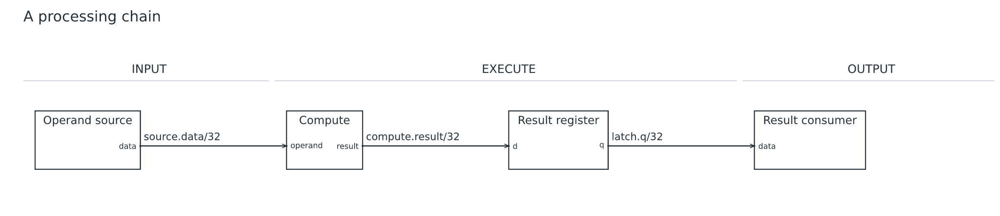
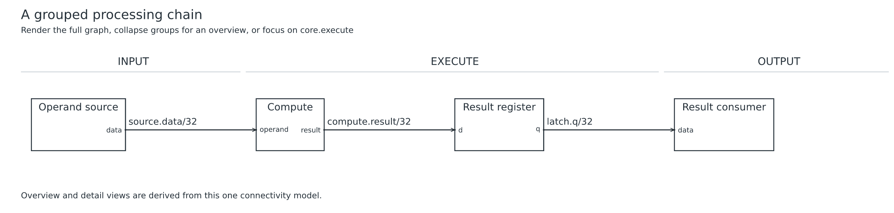
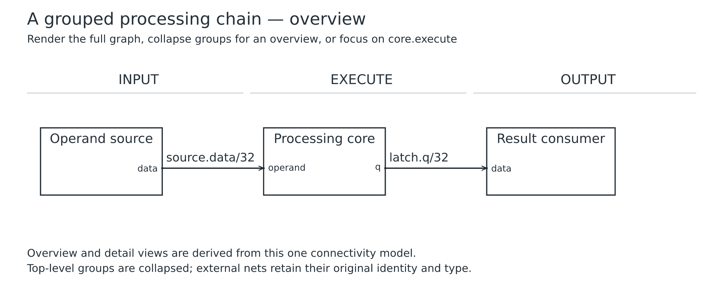
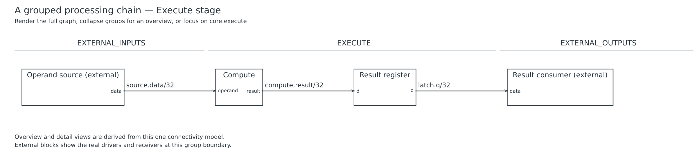
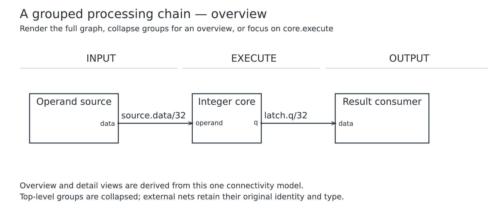

# Lesson 07: Derive hierarchy views

[Course](README.md) · [Previous: Bundles, feedback and a FIFO](06.md) · [Next: Spacing and deliberate layout hints](08.md)

**Goal:** Generate full, overview and detail drawings from one connectivity model.

## Before you start

- Complete lessons 01 and 05. This lesson starts a small processing chain.

Run every command from the repository root after building. Use a plain-text editor. For each step, replace the contents of `work.uarch` with the complete source below. These are runnable checkpoints, not fragments to paste blindly into the previous file. Keep your own edits in `work.uarch`; the checked-in checkpoint is your recovery copy.

## Step 1: Build the complete chain

- Create four blocks and three connections. Compute is a generic block here, not an ALU constructor.
- Keep the architectural stages explicit so source, execution and output remain ordered.

[Complete checkpoint source](07-01-flat.uarch)

```text
uarch 2
title "A processing chain"
param W = 32
stages INPUT EXECUTE OUTPUT
block source in INPUT {
  label "Operand source"
  out data: bits(W)
}
block compute in EXECUTE {
  label "Compute"
  in operand: bits(W)
  out result: bits(W)
}
block latch: register(W) in EXECUTE { label "Result register" }
block consumer in OUTPUT {
  label "Result consumer"
  in data: bits(W)
}
connect source.data -> compute.operand
connect compute.result -> latch.d
connect latch.q -> consumer.data
```

### Run it

```sh
node dist/cli.js check work.uarch
node dist/cli.js render work.uarch -o output/tutorial-work
```

Open `output/tutorial-work.svg` or `output/tutorial-work.png`. Refresh the viewer after each successful render. Compare your result with this image; a different output folder does not change the diagram.

### What you should see

**Checkpoint:** 4 symbols and 3 named nets.

- Four rectangles form a chain with three labeled data nets.
- Compute and Result register are separate components in EXECUTE.



## Step 2: Put execution blocks in nested groups

- Wrap Compute and Result register in group execute, then wrap that group in group core.
- Inside execute, compute.result and latch.d are local references. Outside, use core.execute.compute.operand and core.execute.latch.q.
- Group labels describe views. They do not add electrical ports or change the expanded graph.
- Keep the external source and consumer outside core so the group has real boundary connections.

[Complete checkpoint source](07-02-group.uarch)

```text
uarch 2
title "A grouped processing chain"
subtitle "Render the full graph, collapse groups for an overview, or focus on core.execute"
param W = 32
stages INPUT EXECUTE OUTPUT

block source in INPUT {
  label "Operand source"
  out data: bits(W)
}
group core {
  label "Processing core"
  group execute {
    label "Execute stage"
    block compute in EXECUTE {
      label "Compute"
      in operand: bits(W)
      out result: bits(W)
    }
    block latch: register(W) in EXECUTE { label "Result register" }
    connect compute.result -> latch.d
  }
}
block consumer in OUTPUT {
  label "Result consumer"
  in data: bits(W)
}
connect source.data -> core.execute.compute.operand
connect core.execute.latch.q -> consumer.data
note "Overview and detail views are derived from this one connectivity model."
```

### Run it

```sh
node dist/cli.js check work.uarch
node dist/cli.js render work.uarch -o output/tutorial-work
```

Open `output/tutorial-work.svg` or `output/tutorial-work.png`. Refresh the viewer after each successful render. Compare your result with this image; a different output folder does not change the diagram.

### What you should see

**Checkpoint:** 4 symbols and 3 named nets.

- The ordinary render still shows four components and three nets.
- The grouping changes organization without adding or removing hardware from the full graph.



## Step 3: Collapse the core for an overview

- Keep the same grouped source. Add --overview to the render command below.
- The tool collapses top-level core and derives its boundary ports from the existing nets.
- This is a view of the same model; do not hand-author a second disconnected overview diagram.

[Complete checkpoint source](07-03-overview.uarch)

```text
uarch 2
title "A grouped processing chain"
subtitle "Render the full graph, collapse groups for an overview, or focus on core.execute"
param W = 32
stages INPUT EXECUTE OUTPUT

block source in INPUT {
  label "Operand source"
  out data: bits(W)
}
group core {
  label "Processing core"
  group execute {
    label "Execute stage"
    block compute in EXECUTE {
      label "Compute"
      in operand: bits(W)
      out result: bits(W)
    }
    block latch: register(W) in EXECUTE { label "Result register" }
    connect compute.result -> latch.d
  }
}
block consumer in OUTPUT {
  label "Result consumer"
  in data: bits(W)
}
connect source.data -> core.execute.compute.operand
connect core.execute.latch.q -> consumer.data
note "Overview and detail views are derived from this one connectivity model."
```

### Run it

```sh
node dist/cli.js check work.uarch --overview
node dist/cli.js render work.uarch -o output/tutorial-work --overview
```

Open `output/tutorial-work.svg` or `output/tutorial-work.png`. Refresh the viewer after each successful render. Compare your result with this image; a different output folder does not change the diagram.

### What you should see

**Checkpoint:** 3 symbols and 2 named nets.

- Processing core replaces Compute and Result register.
- Source and Consumer remain visible, with two original boundary nets and their 32-bit types.



## Step 4: Focus on the nested execute group

- Keep the same source and render with --focus core.execute.
- The dotted path selects a nested group. The resulting view adds context blocks for real external drivers and receivers.
- Boundary nets retain their IDs and types; the detail view does not create substitute signals.

[Complete checkpoint source](07-04-detail.uarch)

```text
uarch 2
title "A grouped processing chain"
subtitle "Render the full graph, collapse groups for an overview, or focus on core.execute"
param W = 32
stages INPUT EXECUTE OUTPUT

block source in INPUT {
  label "Operand source"
  out data: bits(W)
}
group core {
  label "Processing core"
  group execute {
    label "Execute stage"
    block compute in EXECUTE {
      label "Compute"
      in operand: bits(W)
      out result: bits(W)
    }
    block latch: register(W) in EXECUTE { label "Result register" }
    connect compute.result -> latch.d
  }
}
block consumer in OUTPUT {
  label "Result consumer"
  in data: bits(W)
}
connect source.data -> core.execute.compute.operand
connect core.execute.latch.q -> consumer.data
note "Overview and detail views are derived from this one connectivity model."
```

### Run it

```sh
node dist/cli.js check work.uarch --focus core.execute
node dist/cli.js render work.uarch -o output/tutorial-work --focus core.execute
```

Open `output/tutorial-work.svg` or `output/tutorial-work.png`. Refresh the viewer after each successful render. Compare your result with this image; a different output folder does not change the diagram.

### What you should see

**Checkpoint:** 4 symbols and 3 named nets.

- Compute and Result register are visible again.
- Operand source (external) and Result consumer (external) explain where data enters and leaves the group.
- The detail has three nets, including the internal compute-to-register connection.



## Try it yourself

Rename the displayed Processing core to Integer core, then render an overview without renaming its group ID.

Make the change in `work.uarch`, then check, render and inspect it before opening the answer.

<details>
<summary>Show the complete answer and expected image</summary>

[Runnable answer](solutions/07.uarch)

- Change the label inside group core. The group ID and qualified port paths remain unchanged.
- Render with --overview to see Integer core as the collapsed block.

```text
uarch 2
title "A grouped processing chain"
subtitle "Render the full graph, collapse groups for an overview, or focus on core.execute"
param W = 32
stages INPUT EXECUTE OUTPUT

block source in INPUT {
  label "Operand source"
  out data: bits(W)
}
group core {
  label "Integer core"
  group execute {
    label "Execute stage"
    block compute in EXECUTE {
      label "Compute"
      in operand: bits(W)
      out result: bits(W)
    }
    block latch: register(W) in EXECUTE { label "Result register" }
    connect compute.result -> latch.d
  }
}
block consumer in OUTPUT {
  label "Result consumer"
  in data: bits(W)
}
connect source.data -> core.execute.compute.operand
connect core.execute.latch.q -> consumer.data
note "Overview and detail views are derived from this one connectivity model."
```

```sh
node dist/cli.js render examples/tutorials/solutions/07.uarch --overview -o output/tutorial-answer-07
```

**Checkpoint:** 3 symbols and 2 named nets.



</details>

## Before you move on

Explain these points using your own drawing:

- Which internal net disappears from the overview, and which boundary nets remain?
- Why do external context blocks appear in the focus view?

Confirm the visible result, not just the command exit code. [Next: Spacing and deliberate layout hints](08.md).
