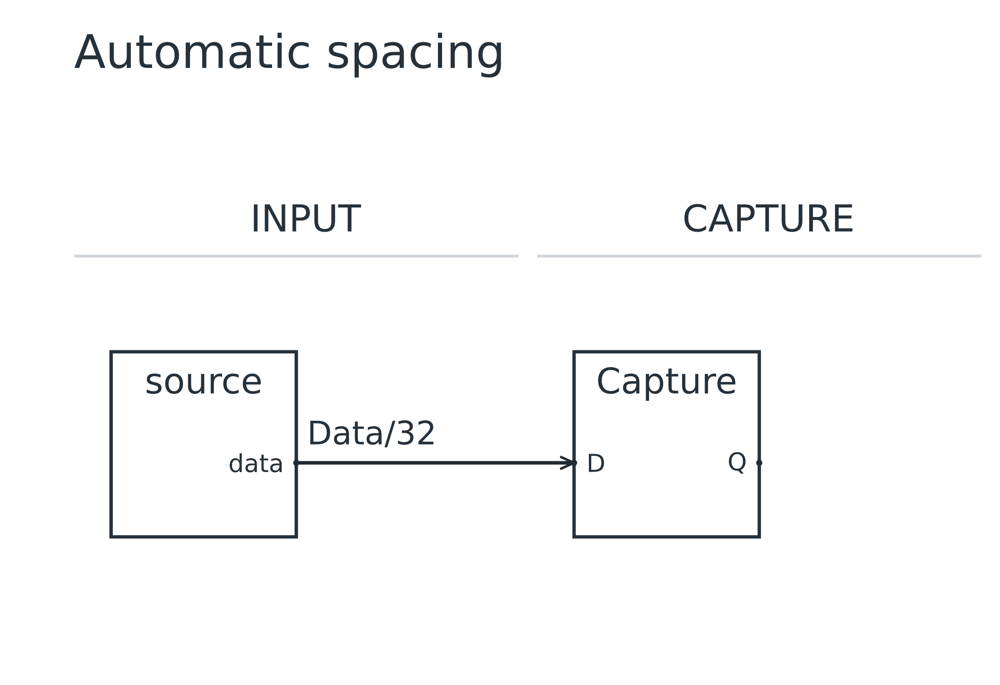
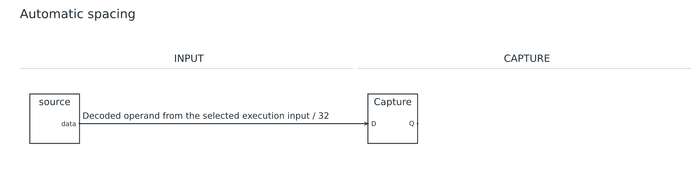
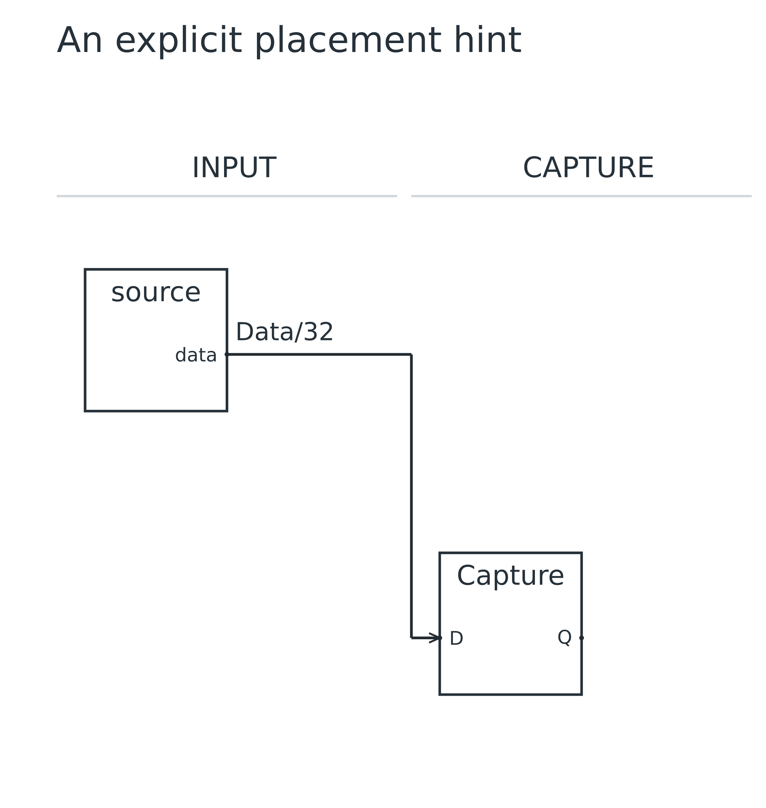
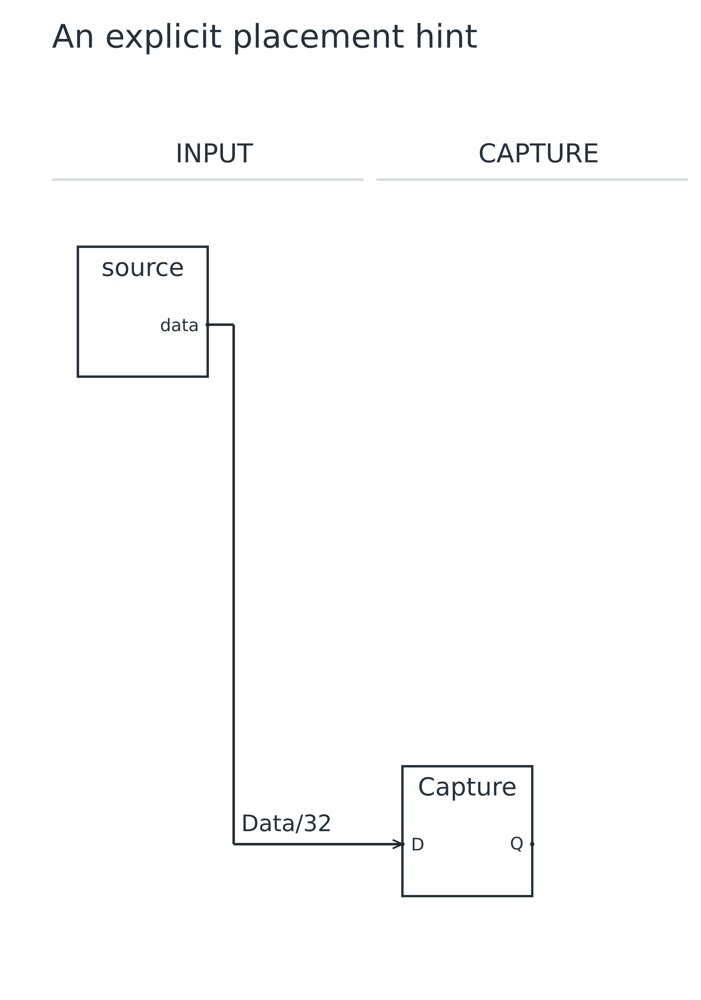

# Lesson 08: Spacing and deliberate layout hints

[Course](README.md) · [Previous: Derive hierarchy views](07.md) · [Next: Build an automatic arbiter](09.md)

**Goal:** Observe automatic spacing recovery and make one explicit placement change.

## Before you start

- Complete lessons 01 and 07. Return to a two-block diagram to isolate layout effects.

Run every command from the repository root after building. Use a plain-text editor. For each step, replace the contents of `work.uarch` with the complete source below. These are runnable checkpoints, not fragments to paste blindly into the previous file. Keep your own edits in `work.uarch`; the checked-in checkpoint is your recovery copy.

## Step 1: Start with automatic placement

- Use no layout section and no @side overrides. The engine measures the symbols and places the blocks.
- Keep this small baseline so the next edit changes only one display label.
- Open the .planning.json companion file to see the number of attempts and effective spacing.
- Capture uses the custom register form from lesson 04. Its D and Q display labels are explicit, so they remain visible when placement becomes fixed. The electrical port IDs stay d and q.

[Complete checkpoint source](08-01-automatic.uarch)

```text
uarch 2
title "Automatic spacing"
stages INPUT CAPTURE
block source in INPUT { out data: bits(32) }
block capture: register in CAPTURE {
  label "Capture"
  in d: bits(32) { label "D" }
  out q: bits(32) { label "Q" }
}
connect source.data -> capture.d { label "Data/32" }
```

### Run it

```sh
node dist/cli.js check work.uarch
node dist/cli.js render work.uarch -o output/tutorial-work
```

Open `output/tutorial-work.svg` or `output/tutorial-work.png`. Refresh the viewer after each successful render. Compare your result with this image; a different output folder does not change the diagram.

### What you should see

**Checkpoint:** 2 symbols and 1 named net.

- One horizontal wire labeled Data/32 connects two blocks.
- The short label fits the initial spacing profile.



## Step 2: Let the planner make room for a long name

- Change only the connection label. Keep its driver, receiver and type unchanged.
- When the name no longer fits, the compiler measures it and retries with a wider gap.
- The planner tries at most four spacing profiles. This is bounded recovery, not a promise that every graph can be routed.

[Complete checkpoint source](08-02-long-label.uarch)

```text
uarch 2
title "Automatic spacing"
stages INPUT CAPTURE
block source in INPUT { out data: bits(32) }
block capture: register in CAPTURE {
  label "Capture"
  in d: bits(32) { label "D" }
  out q: bits(32) { label "Q" }
}
connect source.data -> capture.d { label "Decoded operand from the selected execution input / 32" }
```

### Run it

```sh
node dist/cli.js check work.uarch
node dist/cli.js render work.uarch -o output/tutorial-work
```

Open `output/tutorial-work.svg` or `output/tutorial-work.png`. Refresh the viewer after each successful render. Compare your result with this image; a different output folder does not change the diagram.

### What you should see

**Checkpoint:** 2 symbols and 1 named net.

- The two blocks move farther apart and the full label remains visible.
- The console reports expanded spacing; .planning.json records more than one attempt.
- Compare the topology with the preceding checkpoint: it is still one 32-bit net.



## Step 3: Move the receiver to another row

- Return to the short Data/32 label, then add a layout section inside Capture.
- Specify both column and row to fix this block. Column is local to its stage; row is the shared vertical grid index.
- Automatic peers remain automatic. A layout hint changes presentation, not electrical identity.

[Complete checkpoint source](08-03-anchor.uarch)

```text
uarch 2
title "An explicit placement hint"
stages INPUT CAPTURE
block source in INPUT { out data: bits(32) }
block capture: register in CAPTURE {
  label "Capture"
  in d: bits(32) { label "D" }
  out q: bits(32) { label "Q" }
  layout {
    column 0
    row 1
  }
}
connect source.data -> capture.d { label "Data/32" }
```

### Run it

```sh
node dist/cli.js check work.uarch
node dist/cli.js render work.uarch -o output/tutorial-work
```

Open `output/tutorial-work.svg` or `output/tutorial-work.png`. Refresh the viewer after each successful render. Compare your result with this image; a different output folder does not change the diagram.

### What you should see

**Checkpoint:** 2 symbols and 1 named net.

- Capture appears lower and the data wire bends to reach it.
- There are still two components and one net.
- Use hints only when the automatic result needs a deliberate architectural emphasis.



## Make a mistake and repair it

Try these deliberately broken copies separately from your working file. `check` must exit with status 1 and print the named error; it does not write diagrams. An old preview is not evidence that a failed command succeeded.

### Disable spacing recovery for the long-label source

[Deliberately faulty source](errors/08-no-adaptive.uarch)

```sh
node dist/cli.js check examples/tutorials/errors/08-no-adaptive.uarch --no-adaptive
```

**Expected error fragment:** `No readable label space`.

- Run the same long-label checkpoint with --no-adaptive. Initial spacing is insufficient.
- Remove --no-adaptive to restore the verified result. A failed check writes no output files.

After trying the repair in `work.uarch`, run its normal `check` and `render` commands again. Recover by pasting the matching successful checkpoint if needed.

## Try it yourself

Move Capture one more row down without editing the connection.

Make the change in `work.uarch`, then check, render and inspect it before opening the answer.

<details>
<summary>Show the complete answer and expected image</summary>

[Runnable answer](solutions/08.uarch)

- Set row to 2 and keep column 0. The receiver moves farther down, so the route gets longer.
- The source and destination port IDs remain unchanged.

```text
uarch 2
title "An explicit placement hint"
stages INPUT CAPTURE
block source in INPUT { out data: bits(32) }
block capture: register in CAPTURE {
  label "Capture"
  in d: bits(32) { label "D" }
  out q: bits(32) { label "Q" }
  layout {
    column 0
    row 2
  }
}
connect source.data -> capture.d { label "Data/32" }
```

```sh
node dist/cli.js render examples/tutorials/solutions/08.uarch -o output/tutorial-answer-08
```

**Checkpoint:** 2 symbols and 1 named net.



</details>

## Before you move on

Explain these points using your own drawing:

- Which file reports that spacing expanded, and what does --no-adaptive change?
- Does moving Capture to row 2 change its electrical source?

Confirm the visible result, not just the command exit code. [Next: Build an automatic arbiter](09.md).
