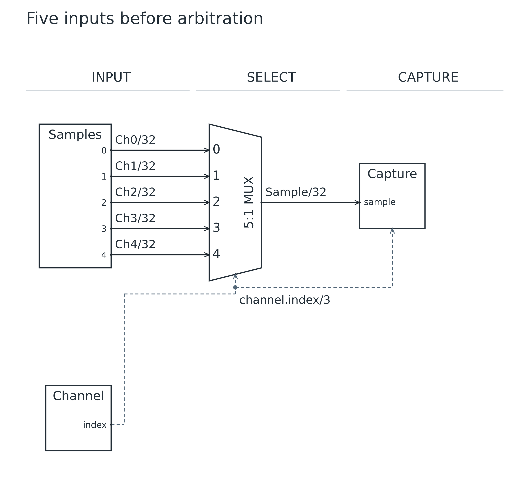
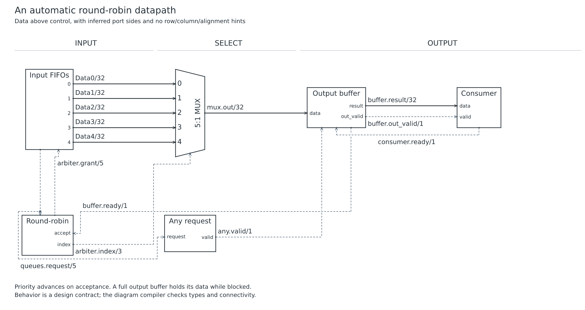
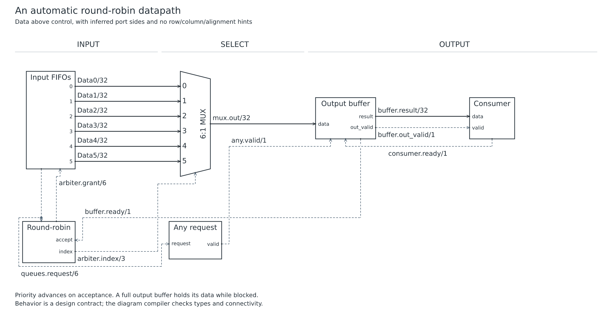
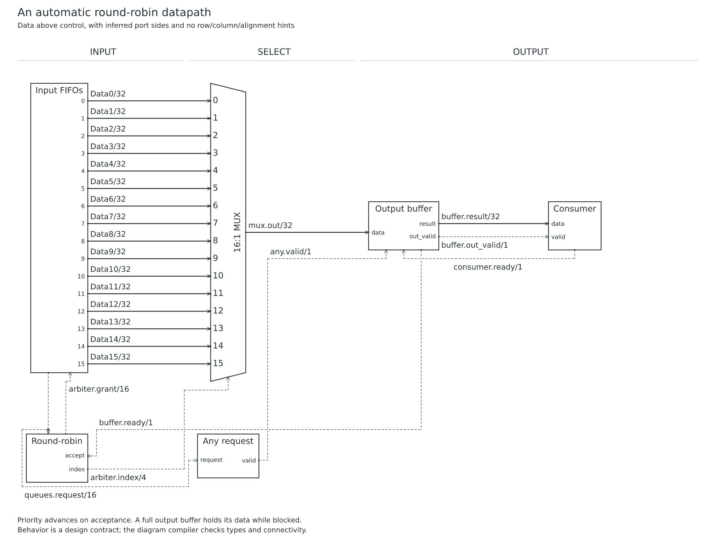

# Lesson 09: Build an automatic arbiter

[Course](README.md) · [Previous: Spacing and deliberate layout hints](08.md) · [Next: advanced reference diagrams](../README.md)

**Goal:** Combine arrays, templates, control lanes and feedback in a common datapath.

## Before you start

- Complete lessons 03–08. Start from the scalable selector rather than the full CPU diagram.

Run every command from the repository root after building. Use a plain-text editor. For each step, replace the contents of `work.uarch` with the complete source below. These are runnable checkpoints, not fragments to paste blindly into the previous file. Keep your own edits in `work.uarch`; the checked-in checkpoint is your recovery copy.

## Step 1: Start with five queue heads

- Start from the templated selector in lesson 05. Set N to 5 and W to 32.
- This checkpoint still gets its index from Channel; it does not yet show requests, grants or output backpressure.

[Complete checkpoint source](09-01-selector.uarch)

```text
uarch 2
title "Five inputs before arbitration"
param N = 5
param W = 32
param INDEX_W = clog2(N)
stages INPUT SELECT CAPTURE
template Samples(COUNT, WIDTH) {
  label "Samples"
  out data[COUNT]: bits(WIDTH) { label "${index}" }
}
block samples: Samples(N, W) in INPUT
block channel in INPUT {
  label "Channel"
  role control
  out index: bits(INDEX_W)
}
block select: mux(N, W) in SELECT
template TaggedCapture(DATA_W, TAG_W): register {
  label "Capture"
  in sample: bits(DATA_W)
  in tag: bits(TAG_W)
}
block capture: TaggedCapture(W, INDEX_W) in CAPTURE
connect samples.data[*] -> select.d[*] { label "Ch${index}/${W}" }
connect channel.index -> select.select, capture.tag { style control }
connect select.out -> capture.sample { label "Sample/${W}" }
```

### Run it

```sh
node dist/cli.js check work.uarch
node dist/cli.js render work.uarch -o output/tutorial-work
```

Open `output/tutorial-work.svg` or `output/tutorial-work.png`. Refresh the viewer after each successful render. Compare your result with this image; a different output folder does not change the diagram.

### What you should see

**Checkpoint:** 4 symbols and 7 named nets.

- Five parallel 32-bit inputs enter a 5:1 MUX.
- The three-bit index also reaches Capture tag.



## Step 2: Add arbitration and output backpressure

- Replace the Samples interface with Queues: retain its data array and add request and grant vectors of N bits.
- Replace Channel with Round-robin: request enters it, grant returns to Queues, and index drives the MUX.
- Add Any request. The same request net fans out to both controllers; its valid output drives Output buffer valid.
- Replace tagged Capture with the buffer/consumer interfaces shown below. Connect buffer data and out_valid forward, consumer.ready back, and buffer.ready to arbiter.accept.
- Read these new connections in that order before rendering. Controllers declare role control; all physical coordinates and alignments remain automatic.

[Complete checkpoint source](09-02-arbiter.uarch)

```text
uarch 2
title "An automatic round-robin datapath"
subtitle "Data above control, with inferred port sides and no row/column/alignment hints"
param N = 5
param W = 32
stages INPUT SELECT OUTPUT

template Queues(N, W) {
  label "Input FIFOs"
  out data[N]: bits(W) { label "${index}" }
  out request: bits(N)
  in grant: bits(N)
}

block queues: Queues(N, W) in INPUT
block arbiter in INPUT {
  label "Round-robin"
  role control
  in request: bits(N)
  in accept: bit
  out grant: bits(N)
  out index: bits(clog2(N))
}
block any in SELECT {
  label "Any request"
  role control
  in request: bits(N)
  out valid: bit
}
block mux: mux(N, W) in SELECT
block buffer: register in OUTPUT {
  label "Output buffer"
  in data: bits(W)
  in valid: bit
  in out_ready: bit
  out ready: bit
  out result: bits(W)
  out out_valid: bit
}
block consumer in OUTPUT {
  label "Consumer"
  in data: bits(W)
  in valid: bit
  out ready: bit
}

connect queues.data[*] -> mux.d[*] { label "Data${index}/${W}" }
connect queues.request -> arbiter.request, any.request
connect arbiter.grant -> queues.grant
connect arbiter.index -> mux.select
connect any.valid -> buffer.valid
connect mux.out -> buffer.data
connect buffer.ready -> arbiter.accept
connect buffer.result -> consumer.data
connect buffer.out_valid -> consumer.valid
connect consumer.ready -> buffer.out_ready
note "Priority advances on acceptance. A full output buffer holds its data while blocked."
note "Behavior is a design contract; the diagram compiler checks types and connectivity."
```

### Run it

```sh
node dist/cli.js check work.uarch
node dist/cli.js render work.uarch -o output/tutorial-work
```

Open `output/tutorial-work.svg` or `output/tutorial-work.png`. Refresh the viewer after each successful render. Compare your result with this image; a different output folder does not change the diagram.

### What you should see

**Checkpoint:** 6 symbols and 14 named nets.

- The five data paths stay above the controllers and lead through Output buffer to Consumer.
- Request, grant, select, valid and ready are individually named dashed signals.
- The diagram has six blocks and fourteen nets. The behavioral contract advances priority only when the buffer accepts data; the compiler does not prove fairness.



## Step 3: Add a sixth queue with one edit

- Change N from 5 to 6. Keep the templates, wildcard connections and layout unchanged.
- Request and grant vectors grow to six bits. The select index stays three bits because clog2(6) is three.

[Complete checkpoint source](09-03-six.uarch)

```text
uarch 2
title "An automatic round-robin datapath"
subtitle "Data above control, with inferred port sides and no row/column/alignment hints"
param N = 6
param W = 32
stages INPUT SELECT OUTPUT

template Queues(N, W) {
  label "Input FIFOs"
  out data[N]: bits(W) { label "${index}" }
  out request: bits(N)
  in grant: bits(N)
}

block queues: Queues(N, W) in INPUT
block arbiter in INPUT {
  label "Round-robin"
  role control
  in request: bits(N)
  in accept: bit
  out grant: bits(N)
  out index: bits(clog2(N))
}
block any in SELECT {
  label "Any request"
  role control
  in request: bits(N)
  out valid: bit
}
block mux: mux(N, W) in SELECT
block buffer: register in OUTPUT {
  label "Output buffer"
  in data: bits(W)
  in valid: bit
  in out_ready: bit
  out ready: bit
  out result: bits(W)
  out out_valid: bit
}
block consumer in OUTPUT {
  label "Consumer"
  in data: bits(W)
  in valid: bit
  out ready: bit
}

connect queues.data[*] -> mux.d[*] { label "Data${index}/${W}" }
connect queues.request -> arbiter.request, any.request
connect arbiter.grant -> queues.grant
connect arbiter.index -> mux.select
connect any.valid -> buffer.valid
connect mux.out -> buffer.data
connect buffer.ready -> arbiter.accept
connect buffer.result -> consumer.data
connect buffer.out_valid -> consumer.valid
connect consumer.ready -> buffer.out_ready
note "Priority advances on acceptance. A full output buffer holds its data while blocked."
note "Behavior is a design contract; the diagram compiler checks types and connectivity."
```

### Run it

```sh
node dist/cli.js check work.uarch
node dist/cli.js render work.uarch -o output/tutorial-work
```

Open `output/tutorial-work.svg` or `output/tutorial-work.png`. Refresh the viewer after each successful render. Compare your result with this image; a different output folder does not change the diagram.

### What you should see

**Checkpoint:** 6 symbols and 15 named nets.

- A sixth horizontal data wire appears and the MUX becomes 6:1.
- The design now has fifteen nets; the control structure remains recognizable.



## Try it yourself

Generate a sixteen-input arbiter without adding port, net or placement statements.

Make the change in `work.uarch`, then check, render and inspect it before opening the answer.

<details>
<summary>Show the complete answer and expected image</summary>

[Runnable answer](solutions/09.uarch)

- Set N to 16. The data array, request/grant vectors and MUX expand together.
- The select index becomes four bits. Open SVG and zoom to inspect the taller figure.

```text
uarch 2
title "An automatic round-robin datapath"
subtitle "Data above control, with inferred port sides and no row/column/alignment hints"
param N = 16
param W = 32
stages INPUT SELECT OUTPUT

template Queues(N, W) {
  label "Input FIFOs"
  out data[N]: bits(W) { label "${index}" }
  out request: bits(N)
  in grant: bits(N)
}

block queues: Queues(N, W) in INPUT
block arbiter in INPUT {
  label "Round-robin"
  role control
  in request: bits(N)
  in accept: bit
  out grant: bits(N)
  out index: bits(clog2(N))
}
block any in SELECT {
  label "Any request"
  role control
  in request: bits(N)
  out valid: bit
}
block mux: mux(N, W) in SELECT
block buffer: register in OUTPUT {
  label "Output buffer"
  in data: bits(W)
  in valid: bit
  in out_ready: bit
  out ready: bit
  out result: bits(W)
  out out_valid: bit
}
block consumer in OUTPUT {
  label "Consumer"
  in data: bits(W)
  in valid: bit
  out ready: bit
}

connect queues.data[*] -> mux.d[*] { label "Data${index}/${W}" }
connect queues.request -> arbiter.request, any.request
connect arbiter.grant -> queues.grant
connect arbiter.index -> mux.select
connect any.valid -> buffer.valid
connect mux.out -> buffer.data
connect buffer.ready -> arbiter.accept
connect buffer.result -> consumer.data
connect buffer.out_valid -> consumer.valid
connect consumer.ready -> buffer.out_ready
note "Priority advances on acceptance. A full output buffer holds its data while blocked."
note "Behavior is a design contract; the diagram compiler checks types and connectivity."
```

```sh
node dist/cli.js render examples/tutorials/solutions/09.uarch -o output/tutorial-answer-09
```

**Checkpoint:** 6 symbols and 25 named nets.



</details>

## Before you move on

Explain these points using your own drawing:

- Which signal returns to the arbiter when the output buffer can accept data?
- What changes when N becomes 6, and which declarations stay exactly the same?

Confirm the visible result, not just the command exit code. [Next: advanced reference diagrams](../README.md).
